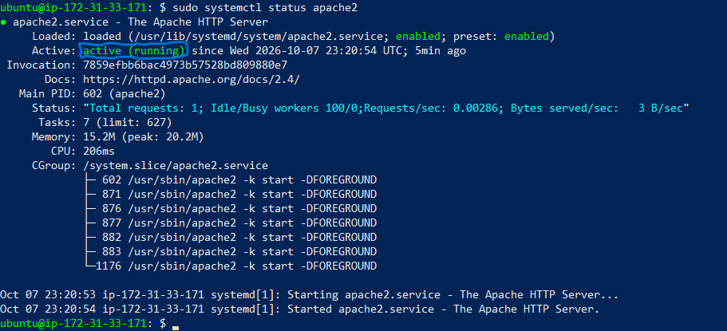
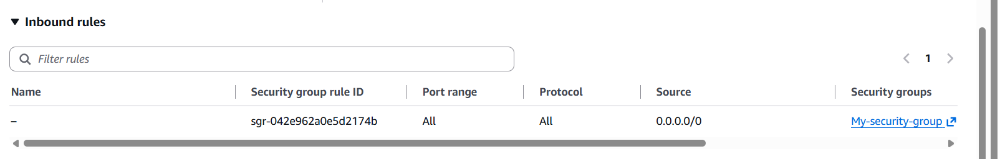
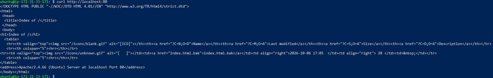
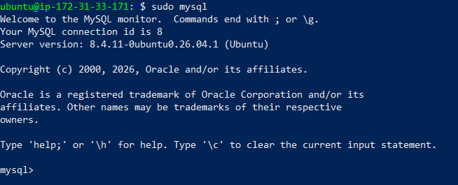
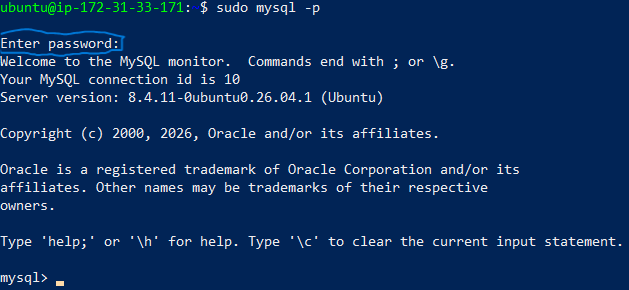
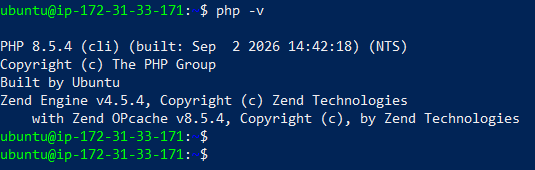
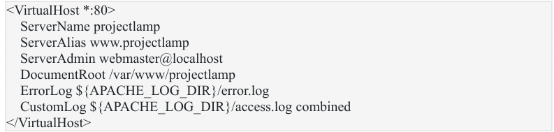
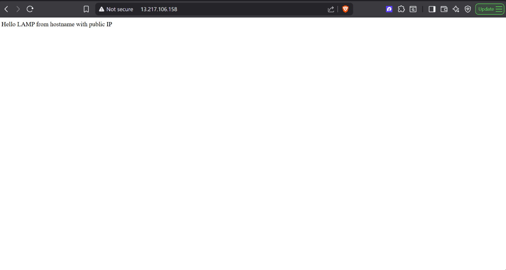
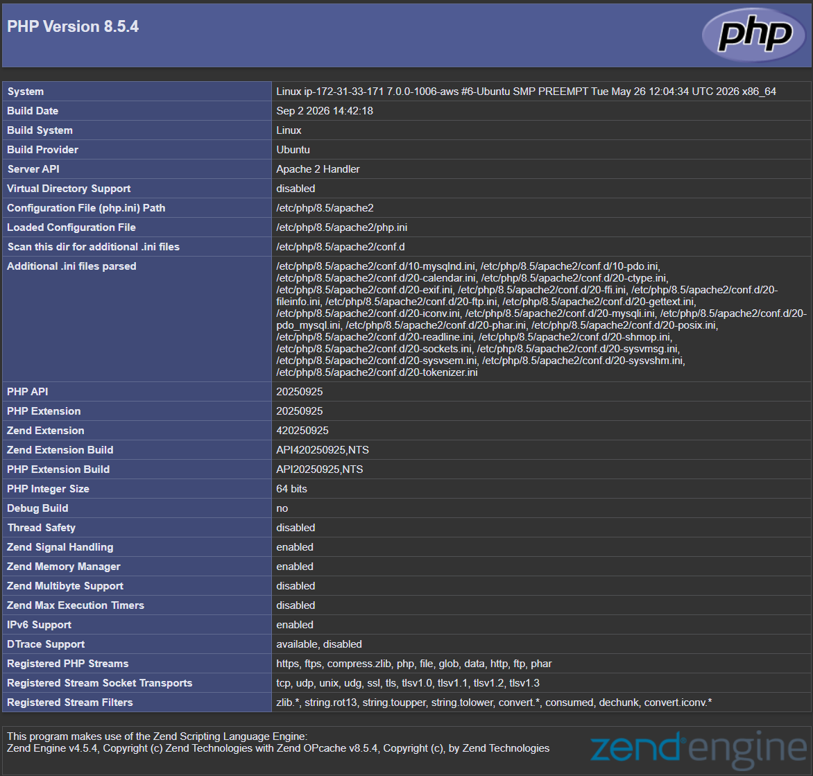

# Project 1: Web Stack Implementation (LAMP Stack) on AWS

A hands-on project where I learn DevOps by building and running real infrastructure on AWS, and documenting every step along the way.

## Goals

- Get comfortable provisioning and managing cloud servers on AWS
- Learn Linux server administration on Ubuntu
- Deploy and serve a web page with Apache2
- Understand the LAMP stack (Linux, Apache, MySQL, PHP)

## Environment

| Item | Value |
|------|-------|
| Cloud provider | AWS (free tier) |
| Service | EC2 |
| Region | eu-north-1 (Stockholm) |
| OS | Ubuntu  26.04 LTS |
| Instance type | t3.micro |
| Connection | SSH from Windows PowerShell |

---

## Step 0: Preparing Prerequisites

To complete this project, I needed an AWS account and a virtual server running Ubuntu.

1. I created an AWS account on the free tier.
2. I launched a new EC2 instance (a virtual server) running Ubuntu.
3. I connected to it over SSH:

```powershell
ssh -i "path\to\your-key.pem" ubuntu@<public-ip-or-dns>
```

> **Important:** I saved my private key (`.pem` file) somewhere safe. If I lose it, I can never connect to this server again. The key must never be committed to Git.

---

## Step 1: Installing Apache and Updating the Firewall

I installed Apache using Ubuntu's package manager, `apt`:

```bash
# Update the list of packages
sudo apt update

# Install Apache
sudo apt install apache2
```

I verified that Apache was running as a service:

```bash
sudo systemctl status apache2
```



Port 22 (SSH) is open on an EC2 instance by default. To serve web traffic, I added an inbound rule for port 80 to the instance's security group:



Then I tested Apache locally from the Ubuntu shell:

```bash
curl http://localhost:80
```



The raw HTML printed in the terminal is Apache's default page.

---

## Step 2: Installing MySQL

I installed the MySQL server:

```bash
sudo apt install mysql-server
```

When prompted to confirm, I typed `y` and pressed Enter.

Then I logged in to the MySQL console:

```bash
sudo mysql
```



On Ubuntu, the MySQL root user uses socket authentication by default, so I set a password for it from inside the console before running the security script:

```sql
ALTER USER 'root'@'localhost' IDENTIFIED WITH mysql_native_password BY '<my-password>';
```

*(Use a strong password of your own and never publish it in this README.)*

To exit the MySQL shell:

```sql
exit
```

Next, I ran the interactive security script (optional, but recommended):

```bash
sudo mysql_secure_installation
```

Then I tested logging in with the new password:

```bash
sudo mysql -p
```



The `-p` flag makes MySQL prompt for the root password I set earlier.

For better security, each database should have its own dedicated user with limited privileges instead of using root everywhere.

MySQL is now installed and secured. Next is PHP, the final component of my LAMP stack.

---

## Step 3: Installing PHP

Apache serves my content and MySQL stores and manages my data. PHP processes the code that generates dynamic content.

Along with the `php` package, I installed `php-mysql` (so PHP can talk to MySQL) and `libapache2-mod-php` (so Apache can handle PHP files):

```bash
sudo apt install php libapache2-mod-php php-mysql
```

I checked that it installed correctly:

```bash
php -v
```



The LAMP stack is now fully installed and operational:

- **L**inux (Ubuntu)
- **A**pache HTTP Server
- **M**ySQL
- **P**HP

Next, I configured my first virtual host.

---

## Step 4: Creating a Virtual Host for My Website Using Apache

I created a directory named `projectlamp`:

```bash
sudo mkdir /var/www/projectlamp
```

I assigned ownership to my current system user:

```bash
sudo chown -R $USER:$USER /var/www/projectlamp
```

I created and opened a new Apache configuration file:

```bash
sudo vi /etc/apache2/sites-available/projectlamp.conf
```

I added this configuration:

```apache
<VirtualHost *:80>
    ServerName projectlamp
    ServerAlias www.projectlamp
    ServerAdmin webmaster@localhost
    DocumentRoot /var/www/projectlamp
    ErrorLog ${APACHE_LOG_DIR}/error.log
    CustomLog ${APACHE_LOG_DIR}/access.log combined
</VirtualHost>
```



Then I enabled the new virtual host, disabled Apache's default site, checked the configuration, and reloaded Apache:

```bash
# Enable the new virtual host
sudo a2ensite projectlamp

# Disable Apache's default website
sudo a2dissite 000-default

# Check the configuration for syntax errors
sudo apache2ctl configtest

# Reload Apache so the changes take effect
sudo systemctl reload apache2
```

To test the virtual host, I created an `index.html` that prints the server's public hostname and IP:

```bash
sudo echo 'Hello LAMP from hostname' $(curl -s http://169.254.169.254/latest/meta-data/public-hostname) 'with public IP' $(curl -s http://169.254.169.254/latest/meta-data/public-ipv4) > /var/www/projectlamp/index.html
```

The virtual host is working:



---

## Step 5: Enabling PHP on the Website

By default, Apache serves `index.html` before `index.php`. I opened the directory index configuration:

```bash
sudo vim /etc/apache2/mods-enabled/dir.conf
```

and changed the order so `index.php` comes first.

Before:

```apache
<IfModule mod_dir.c>
    DirectoryIndex index.html index.cgi index.pl index.php index.xhtml index.htm
</IfModule>
```

After:

```apache
<IfModule mod_dir.c>
    DirectoryIndex index.php index.html index.cgi index.pl index.xhtml index.htm
</IfModule>
```

I reloaded Apache for the change to take effect:

```bash
sudo systemctl reload apache2
```

Then I created an `index.php` file to test that PHP is installed and configured correctly:

```bash
vim /var/www/projectlamp/index.php
```

with this content:

```php
<?php
phpinfo();
```

PHP is installed and working:



> **Note:** I removed this file afterwards because `phpinfo()` exposes sensitive information about the server.

```bash
sudo rm /var/www/projectlamp/index.php
```

---

## Troubleshooting & Lessons Learned

- A stopped and restarted EC2 instance gets a new public IP unless an Elastic IP is attached.

## Cleanup

To avoid unexpected charges, I stop or terminate the instance when I'm not using it.

## Author

Dubemox · Lagos, Nigeria