# Project 2: Web Stack Implementation (LEMP Stack) on AWS

A hands-on project where I learn DevOps by building and running real infrastructure on AWS, and documenting every step along the way.

## Goals

- Get comfortable with basic SQL syntax
- Get familiar with the vim and nano editors
- Understand the LEMP stack (Linux, Nginx, MySQL, PHP)

## Environment

| Item | Value |
|------|-------|
| Cloud provider | AWS (free tier) |
| Service | EC2 |
| Region | eu-north-1 (Stockholm) |
| OS | Ubuntu 26.04 LTS |
| Instance type | e.g. t3.micro |
| Connection | SSH from Windows PowerShell |

---

## Step 0: Preparing Prerequisites

To complete this project, I needed the AWS free tier account I created in [Project 1](link-to-project-1).

1. I launched a new EC2 instance. Its status is **Running**:

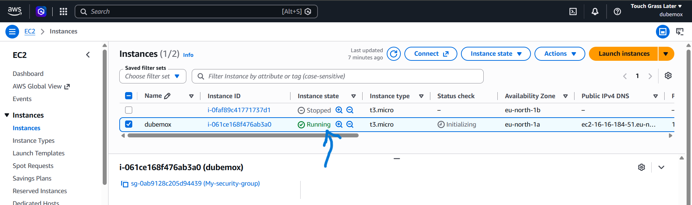

2. I connected to it with an SSH client:

```powershell
ssh -i "path\to\your-key.pem" ubuntu@<public-ip-or-dns>
```

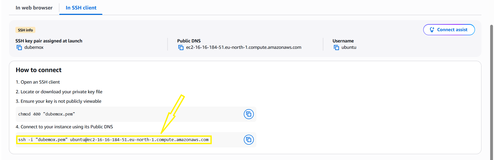

---

## Step 1: Installing the Nginx Web Server

In a LEMP stack, **Nginx** replaces Apache as the web server.

I used `apt` to update the package list and install Nginx:

```bash
# Update the list of packages
sudo apt update

# Install Nginx
sudo apt install nginx
```

I confirmed that Nginx was installed and running:

```bash
sudo systemctl status nginx
```

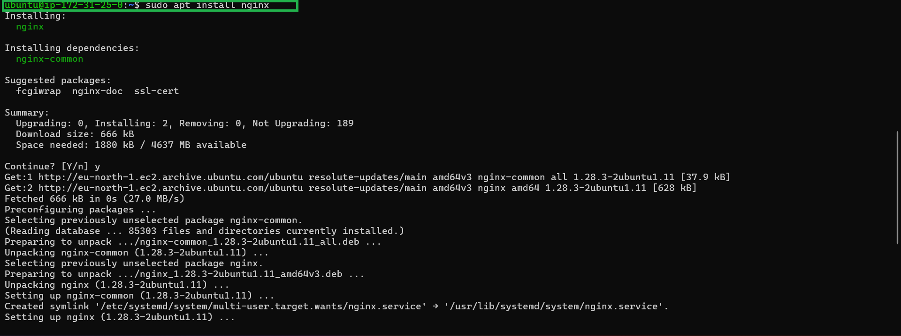

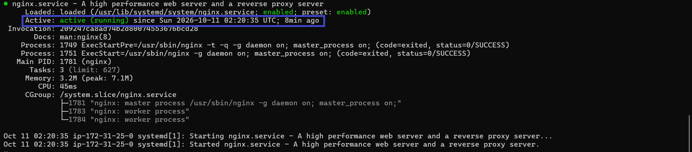

I added an inbound rule for port 80 to the instance's security group so the server can be reached from the internet:

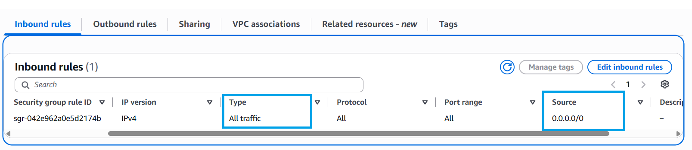

I tested Nginx locally from the Ubuntu shell:

```bash
curl http://localhost:80
```

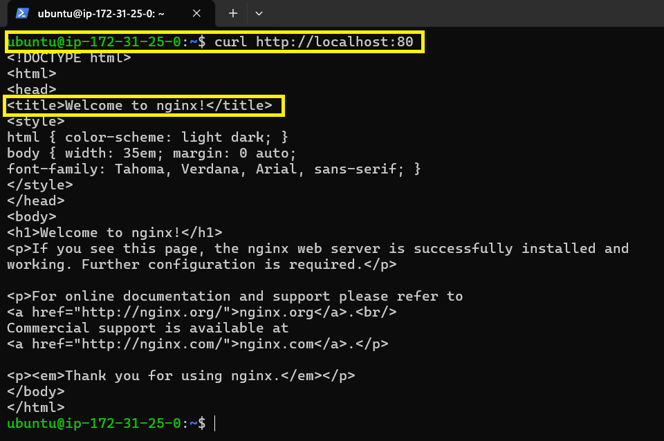

Then I tested it from the internet by opening the server's public address in a browser:

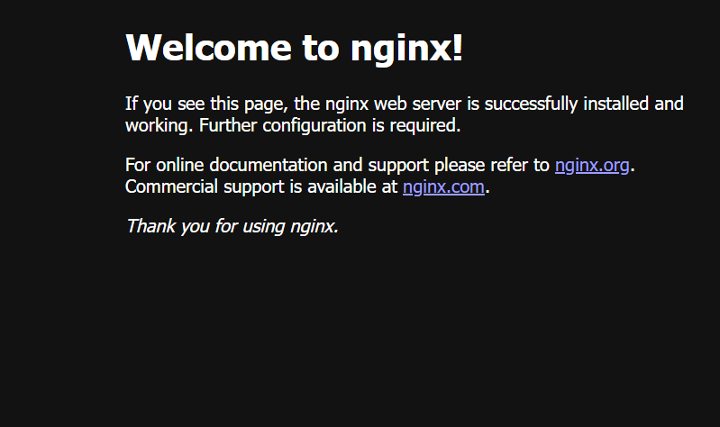

---

## Step 2: Installing MySQL

I installed MySQL:

```bash
sudo apt install mysql-server
```

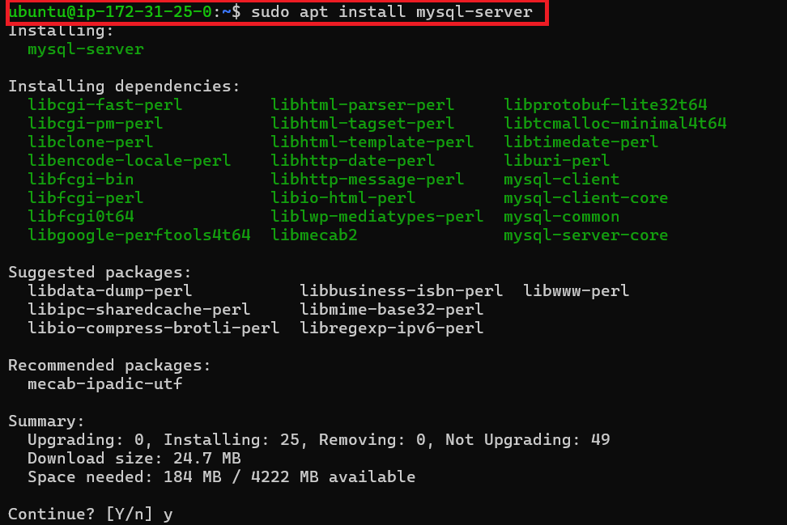

Then I logged in to the MySQL console:

```bash
sudo mysql
```

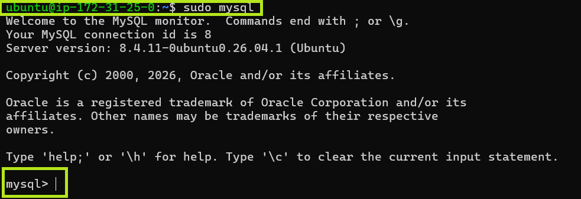

I tried to set a password for the root user, but I got an error:

```sql
ALTER USER 'root'@'localhost' IDENTIFIED WITH mysql_native_password BY 
'PassWord.1';
```

```text
ERROR 1524 (HY000): Plugin 'mysql_native_password' is not loaded
```

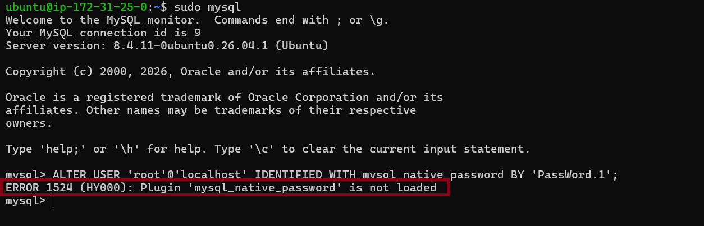

To fix it, I enabled the required plugin by editing MySQL's configuration file:

```bash
sudo vi /etc/mysql/mysql.conf.d/mysqld.cnf
```

```ini
mysql_native_password=ON
```

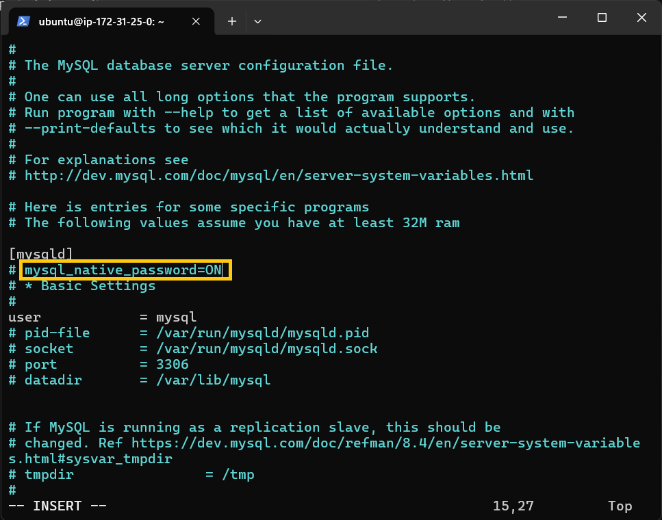

I restarted MySQL for the change to take effect:

```bash
sudo systemctl restart mysql
```

After that, I was able to set the root password (use a strong password of your own and never publish it in this README):

```sql
ALTER USER 'root'@'localhost' IDENTIFIED WITH mysql_native_password BY '<your-password>';
```

Then I ran the security script:

```bash
sudo mysql_secure_installation
```

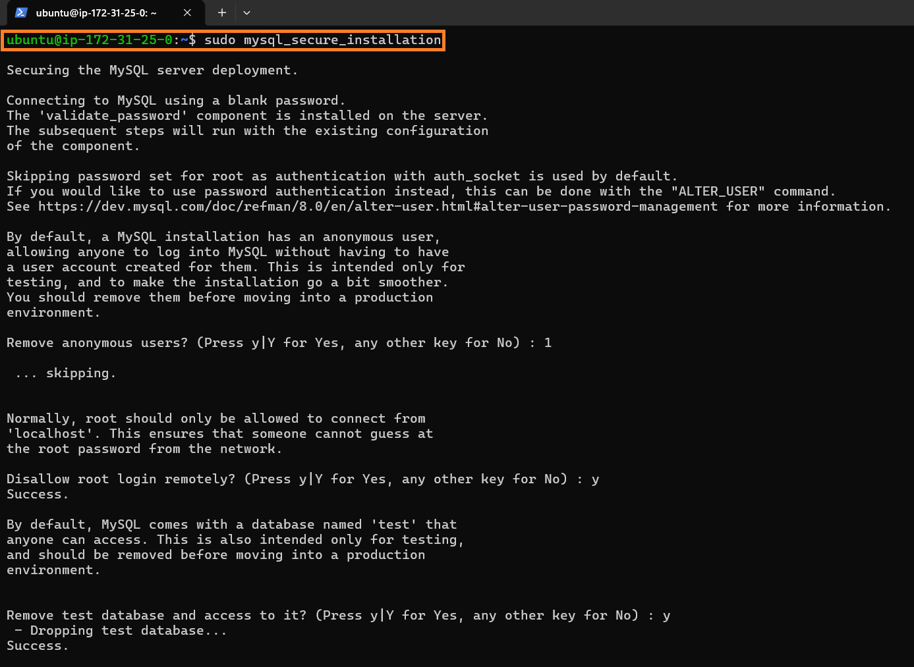

Finally, I tested the login with the `-p` flag, which prompts for the root password:

```bash
sudo mysql -p
```

The login worked:

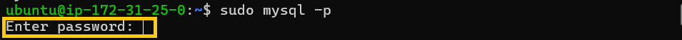

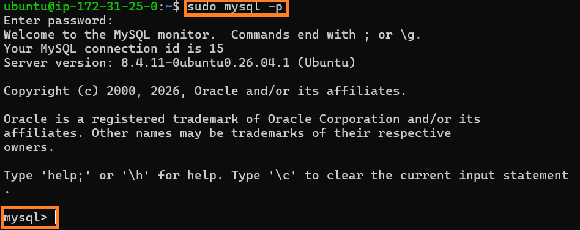

---

## Step 3: Installing PHP

Nginx can't process PHP files by itself. It hands them to a separate processor, **PHP-FPM** (FastCGI Process Manager). I also installed `php-mysql` so PHP can communicate with the MySQL database:

```bash
sudo apt install php-fpm php-mysql
```

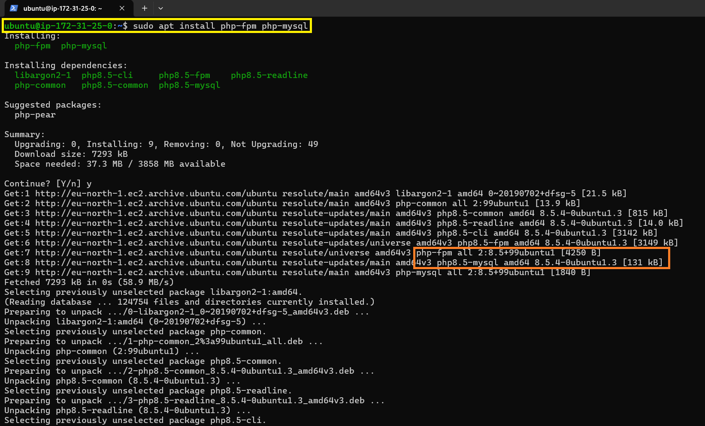

Next, I configured Nginx to use PHP.

---

## Step 4: Configuring Nginx to Use the PHP Processor

I created a web root directory for my site:

```bash
sudo mkdir /var/www/projectLEMP
```

I assigned ownership to my current system user:

```bash
sudo chown -R $USER:$USER /var/www/projectLEMP
```

I opened a new configuration file in Nginx's `sites-available` directory:

```bash
sudo vi /etc/nginx/sites-available/projectLEMP
```

and added this configuration:

```nginx
server {
    listen 80;
    server_name projectLEMP www.projectLEMP;
    root /var/www/projectLEMP;

    index index.html index.htm index.php;

    location / {
        try_files $uri $uri/ =404;
    }

    location ~ \.php$ {
        include snippets/fastcgi-php.conf;
        fastcgi_pass unix:/var/run/php/php8.1-fpm.sock;
    }

    location ~ /\.ht {
        deny all;
    }
}
```

> **Note:** The socket filename must match the PHP version installed on your server. Run `ls /var/run/php/` to check it.

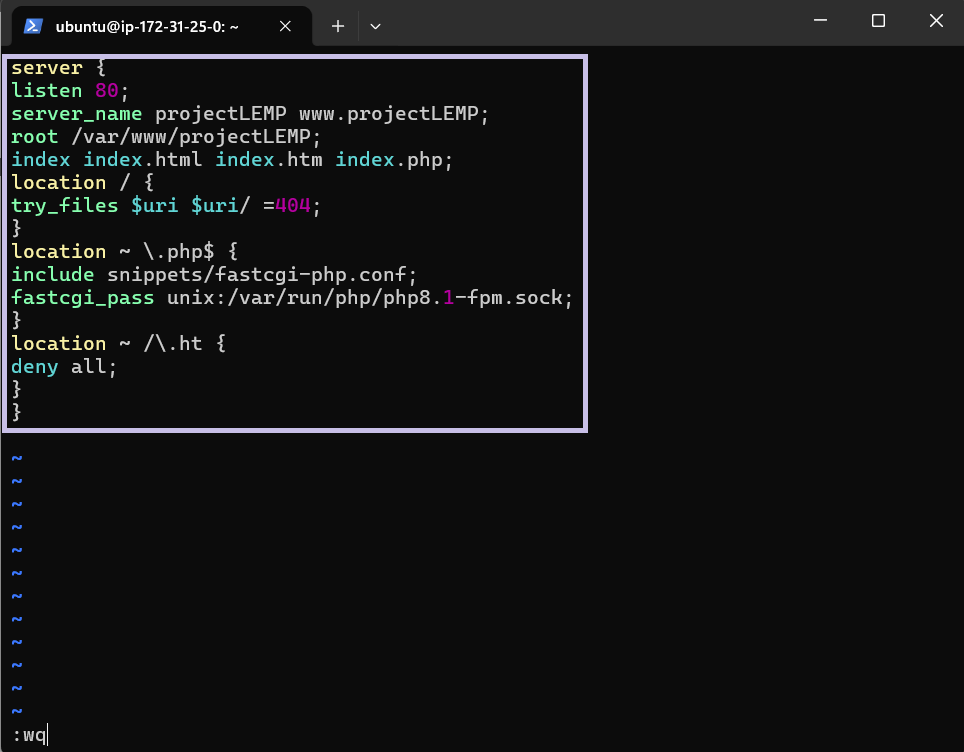

I activated the configuration by linking it to the `sites-enabled` directory:

```bash
sudo ln -s /etc/nginx/sites-available/projectLEMP /etc/nginx/sites-enabled/
```

I tested the configuration for syntax errors:

```bash
sudo nginx -t
```

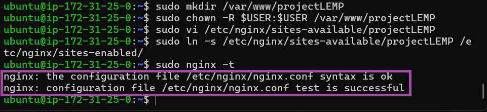

I disabled Nginx's default site:

```bash
sudo unlink /etc/nginx/sites-enabled/default
```

I reloaded Nginx for the changes to take effect:

```bash
sudo systemctl reload nginx
```

To test that the server works as expected, I created an `index.html` that prints the server's public hostname and IP:

```bash
echo 'Hello LEMP from hostname' $(curl -s http://169.254.169.254/latest/meta-data/public-hostname) 'with public IP' $(curl -s http://169.254.169.254/latest/meta-data/public-ipv4) | sudo tee /var/www/projectLEMP/index.html
```

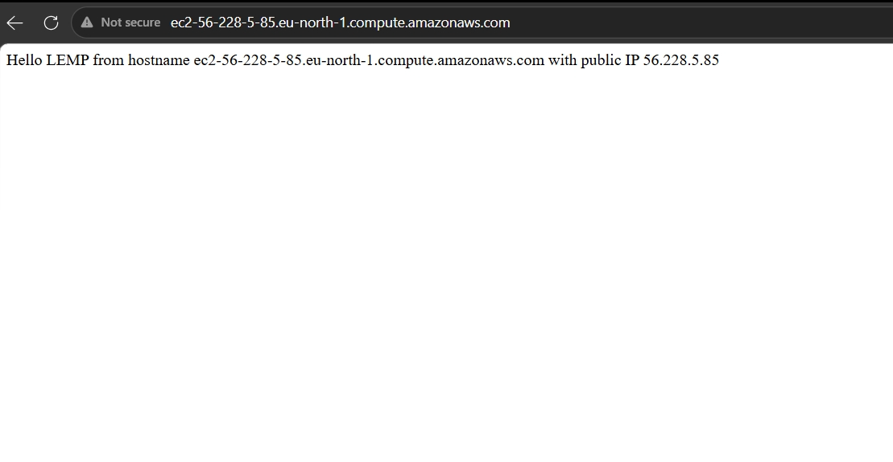

Next, I renamed `index.html` so Nginx would stop serving it:

```bash
sudo mv /var/www/projectLEMP/index.html /var/www/projectLEMP/index.html.bak
```

I also edited the site configuration again so that `index.php` takes priority:

```bash
sudo vi /etc/nginx/sites-available/projectLEMP
```

```nginx
index index.php index.html index.htm;
```

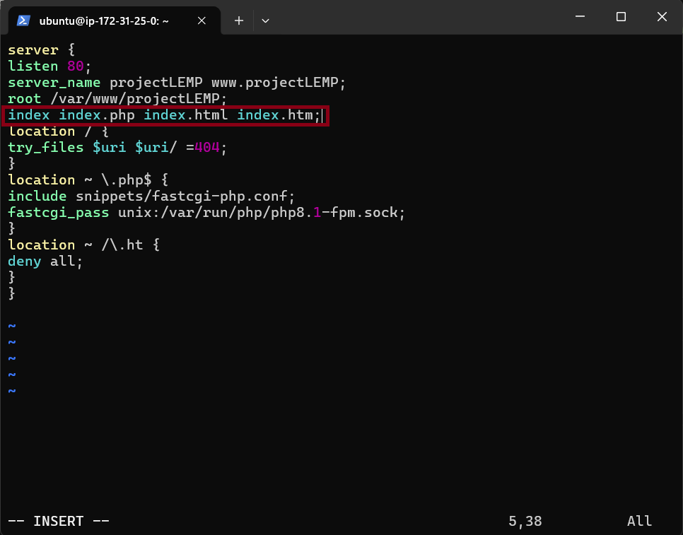

I tested and reloaded Nginx again:

```bash
sudo nginx -t
sudo systemctl reload nginx
```

---

## Step 5: Testing PHP with Nginx

To validate that Nginx can hand `.php` files to the PHP processor, I created an `info.php` file:

```bash
sudo vi /var/www/projectLEMP/info.php
```

with this content:

```php
<?php
phpinfo();
```

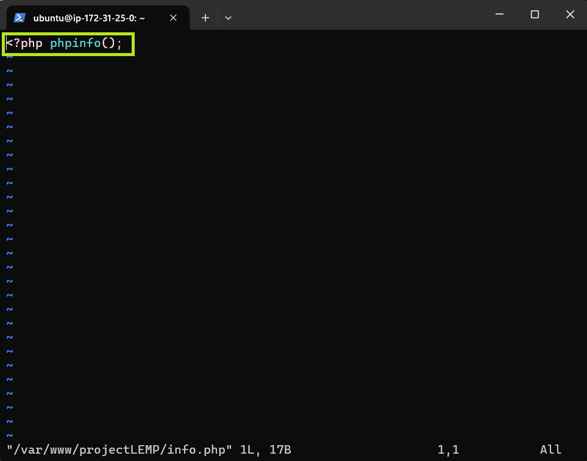

I opened the page in my web browser:

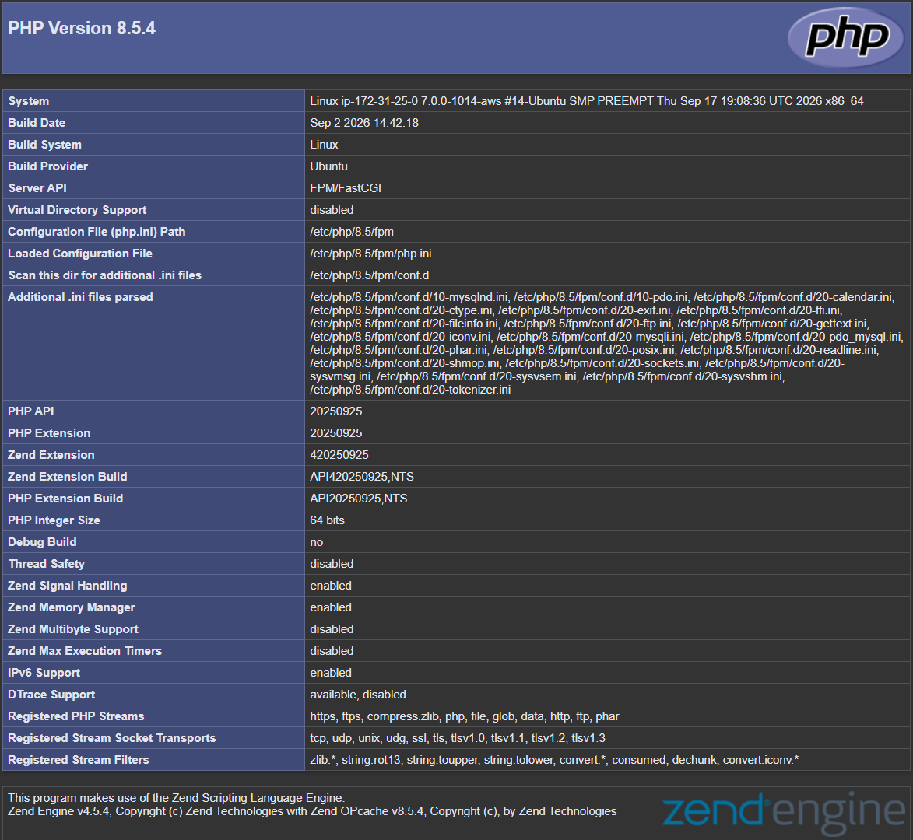

> **Note:** I removed this file afterwards because `phpinfo()` exposes sensitive information about the server.

```bash
sudo rm /var/www/projectLEMP/info.php
```

---

## Step 6: Retrieving Data from the MySQL Database with PHP

I connected to the MySQL console:

```bash
sudo mysql
```

I created a database:

```sql
CREATE DATABASE example_database;
```

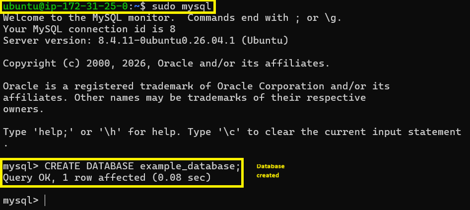

I created a new user with a strong password:

```sql
CREATE USER 'example_user'@'%' IDENTIFIED BY '<your-password>';
```

I gave that user permissions on `example_database`:

```sql
GRANT ALL ON example_database.* TO 'example_user'@'%';
```

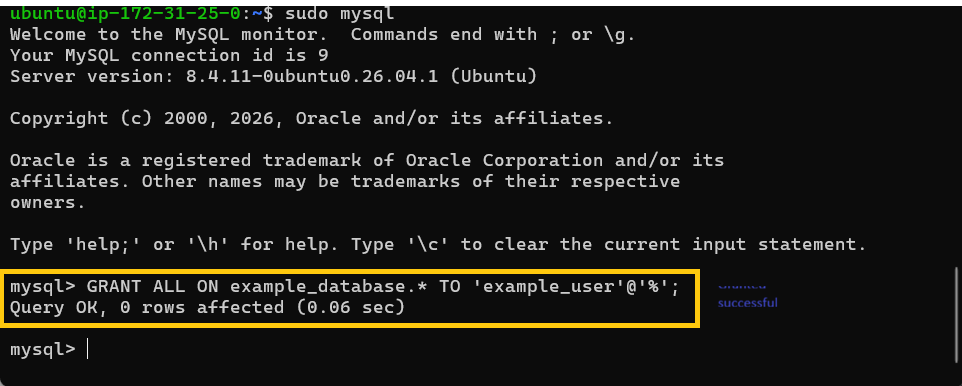

Then I exited the console:

```sql
exit
```

To check that the new user has the right permissions, I logged in as that user:

```bash
mysql -u example_user -p
```

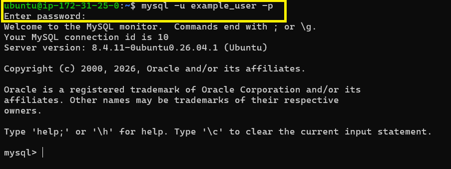

Inside the MySQL console, I confirmed access to the database:

```sql
SHOW DATABASES;
```

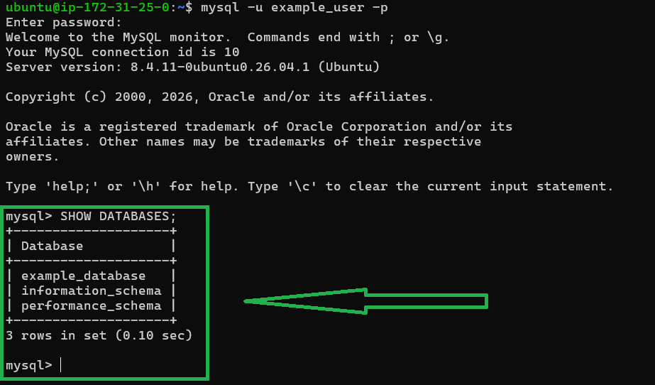

I created a test table named `todo_list`:

```sql
CREATE TABLE example_database.todo_list (
    item_id INT AUTO_INCREMENT,
    content VARCHAR(255),
    PRIMARY KEY (item_id)
);
```

I added two rows and checked the table:

```sql
-- Row 1
INSERT INTO example_database.todo_list (content) VALUES ('My first important item');

-- Row 2
INSERT INTO example_database.todo_list (content) VALUES ('My second important item');

-- Check the table
SELECT * FROM example_database.todo_list;
```

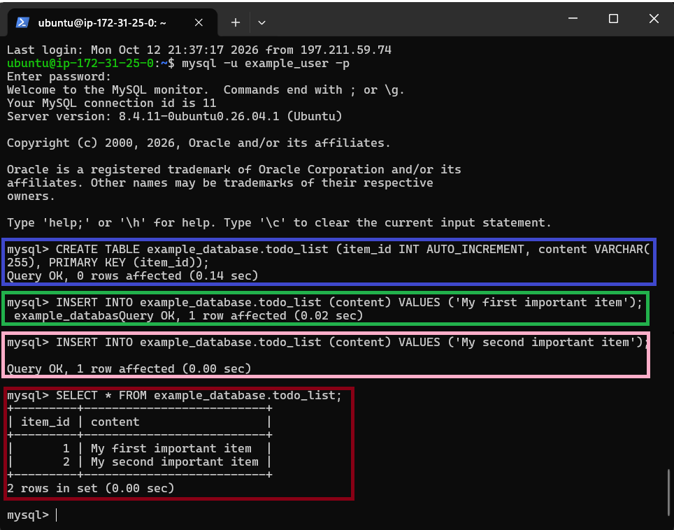

Then I exited:

```sql
exit
```

I created a PHP script that connects to the database and prints the todo list:

```bash
sudo vi /var/www/projectLEMP/todo_list.php
```

```php
<?php
$user = "example_user";
$password = "<your-password>";
$database = "example_database";
$table = "todo_list";

try {
    $db = new PDO("mysql:host=localhost;dbname=$database", $user, $password);
    echo "<h2>TODO</h2><ol>";
    foreach ($db->query("SELECT content FROM $table") as $row) {
        echo "<li>" . $row['content'] . "</li>";
    }
    echo "</ol>";
} catch (PDOException $e) {
    print "Error!: " . $e->getMessage() . "<br/>";
    die();
}
```

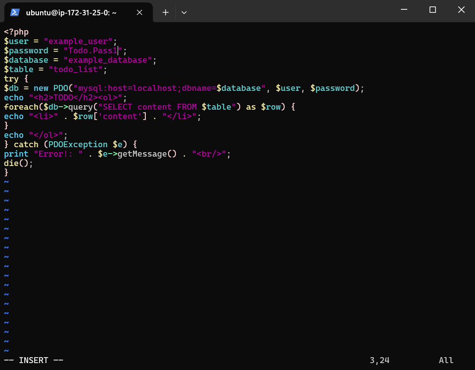

I opened the page in my browser:

```text
http://<public-domain-or-ip>/todo_list.php
```

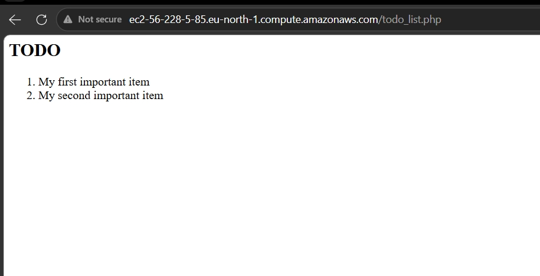

---

## Troubleshooting & Lessons Learned

- The PHP-FPM socket path in the Nginx config must match the installed PHP version.

## Cleanup

To avoid unexpected charges, I stop or terminate the instance when I'm not using it.

## Author

Dubemox · Lagos, Nigeria.