# Project 4: MEAN Stack Deployment to Ubuntu on AWS

A hands-on project where I learn DevOps by building and running real infrastructure on AWS, and documenting every step along the way.

## Goals

- Understand the MEAN stack and how its components work together
- Deploy a simple Book Register web form using the MEAN stack on an Ubuntu server

## The MEAN Stack

| Letter | Technology | Role |
|--------|------------|------|
| **M** | MongoDB | NoSQL database that stores the data |
| **E** | Express.js | Web framework for building the backend API |
| **A** | AngularJS | Frontend framework that builds the user interface and sends requests to the API |
| **N** | Node.js | JavaScript runtime that runs the backend |

## Environment

| Item | Value |
|------|-------|
| Cloud provider | AWS (free tier) |
| Service | EC2 |
| Region | eu-north-1 (Stockholm) |
| OS | Ubuntu 26.04 LTS |
| Instance type | t3.micro |
| Database | MongoDB Atlas (free cluster) |
| Connection | SSH from Windows PowerShell |

---

## Step 0: Preparing Prerequisites

I launched a new EC2 instance and confirmed it was running:

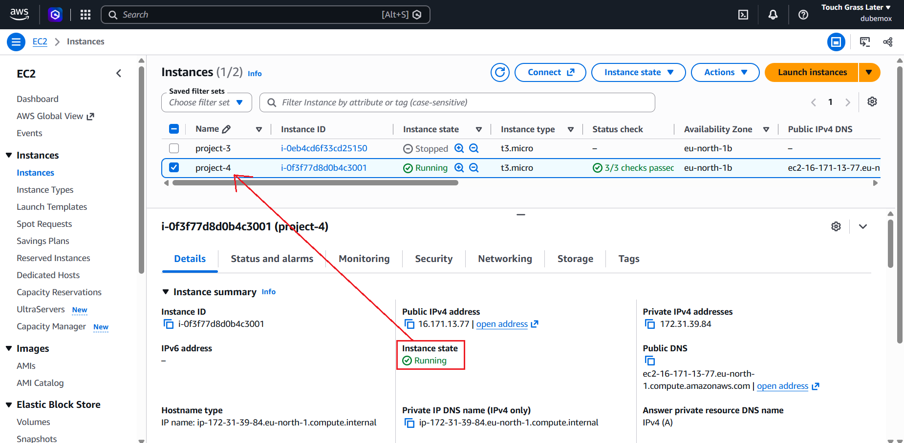

I connected to it using SSH:

```powershell
ssh -i "path\to\your-key.pem" ubuntu@<public-ip-or-dns>
```

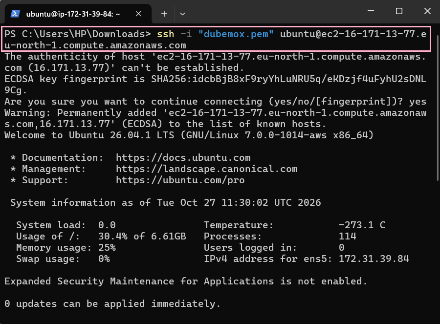

**Task:** deploy a simple Book Register web form using the MEAN stack.

---

## Step 1: Installing Node.js

I updated and upgraded Ubuntu:

```bash
# Update the list of packages
sudo apt update

# Upgrade the installed packages
sudo apt upgrade
```

I installed some certificates and tools that the Node.js repository setup needs:

```bash
sudo apt -y install curl dirmngr apt-transport-https lsb-release ca-certificates gnupg
```

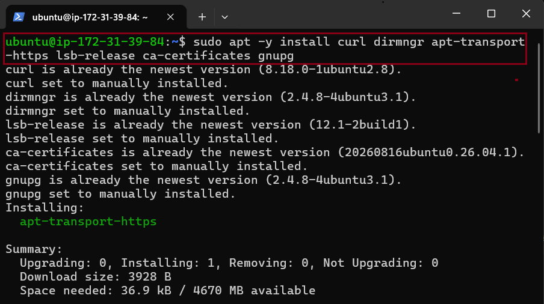

I added the Node.js repository (NodeSource):

```bash
curl -fsSL https://deb.nodesource.com/setup_22.x | sudo -E bash -
```

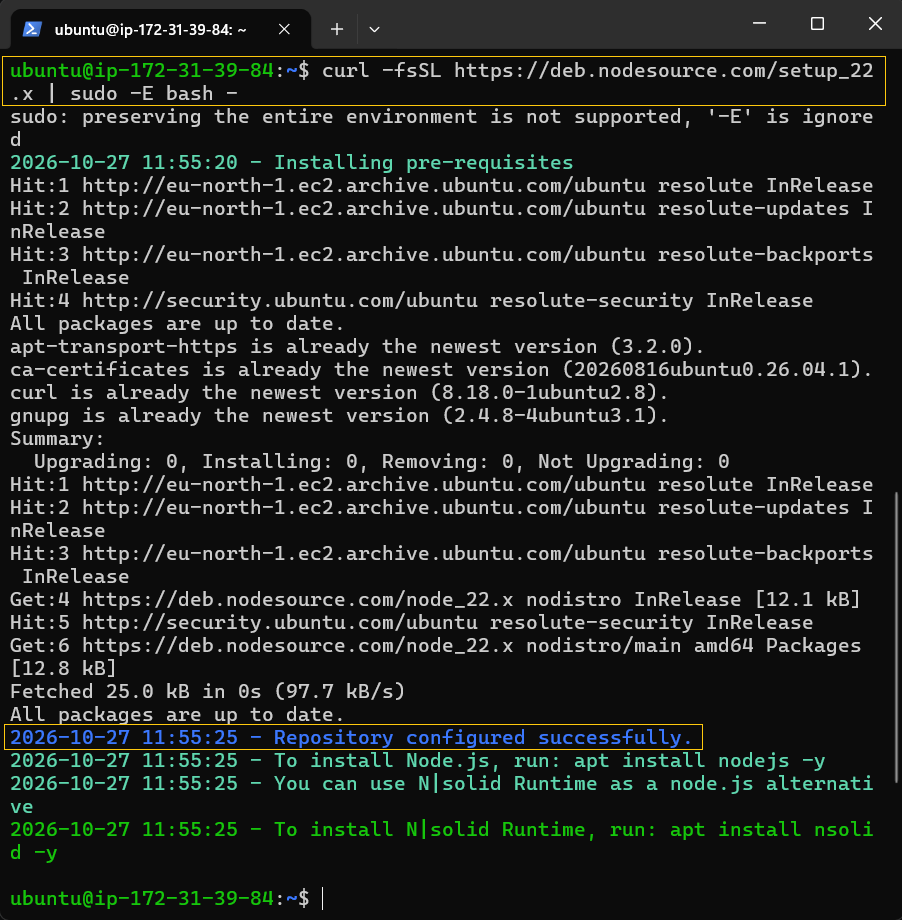

I installed Node.js:

```bash
sudo apt install -y nodejs
```

I verified the installation:

```bash
node -v
npm -v
```

---

## Step 2: Connecting to MongoDB

I created a free cluster in MongoDB Atlas:

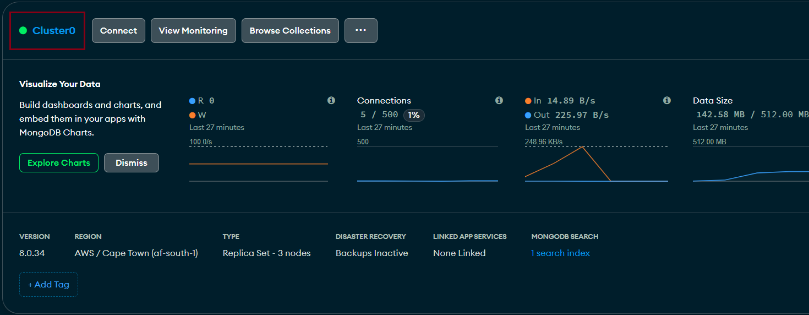

I added a database user:

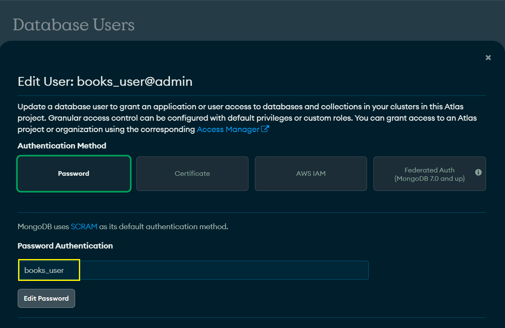

I allowed access from all IPv4 addresses. This is **not secure**, but it is fine for testing:

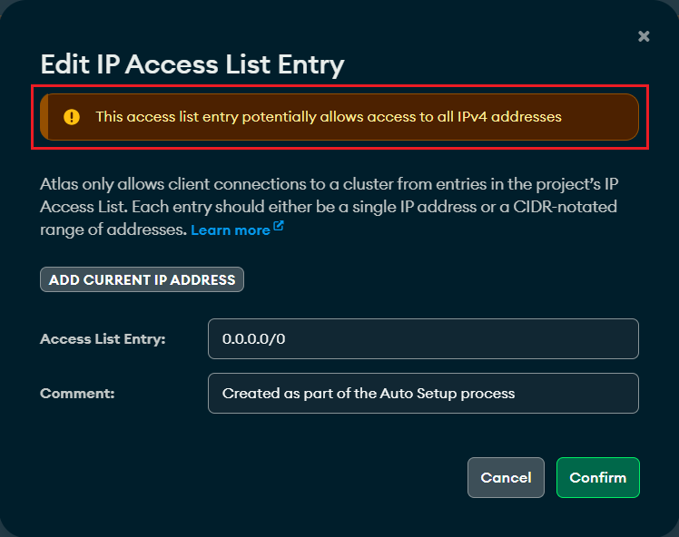

I created a directory named `Books`, moved into it, and initialized a Node.js project:

```bash
# Create the directory and enter it
mkdir Books && cd Books

# Initialize the project
npm init -y

# Install the dependencies
npm install express body-parser mongoose dotenv
```

`body-parser` lets the server read JSON in incoming requests, `mongoose` makes working with MongoDB easier, and `dotenv` loads environment variables from a `.env` file.

I created a `server.js` file and added the application code:

```bash
vi server.js
```

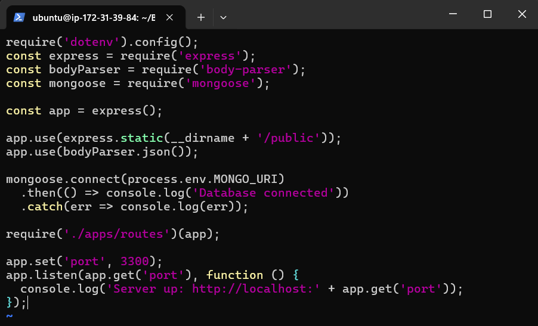

I created a `.env` file in the `Books` directory to hold my MongoDB connection string:

```bash
vi .env
```

```text
MONGODB_URI="mongodb+srv://<db_user>:<db_password>@<cluster-address>/books?retryWrites=true&w=majority"
```

> **Important:** Never commit `.env` to Git or publish your real connection string. Add `.env` and `node_modules` to `.gitignore`.

*(The variable name must match what `server.js` reads from `process.env`.)*

---

## Step 3: Setting Up the Routes

I created an `apps` folder inside the `Books` directory:

```bash
mkdir apps && cd apps
```

I created a file named `routes.js` and added the code:

```bash
vi routes.js
```

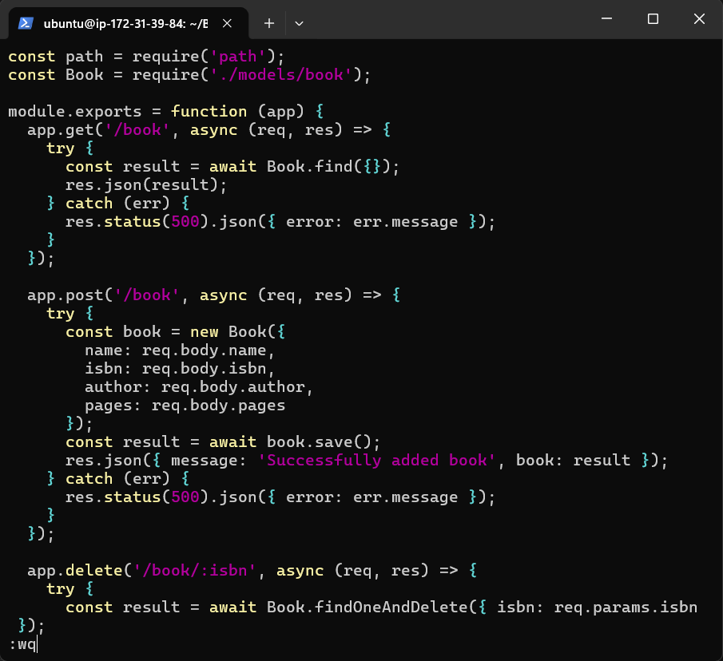

I created a `models` folder inside the `apps` directory:

```bash
mkdir models && cd models
```

I created a file named `book.js` and added the code:

```bash
vi book.js
```

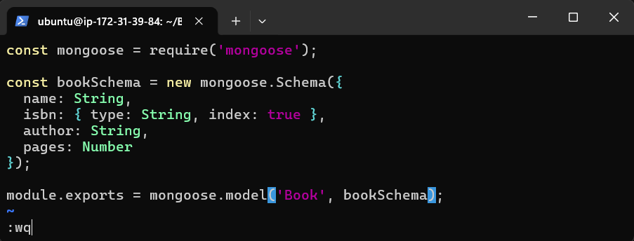

---

## Step 4: Accessing the Routes with AngularJS

I went back to the `Books` directory, then created a folder named `public` and moved into it:

```bash
cd ../..
mkdir public && cd public
```

I created a file named `script.js`, which holds the AngularJS controller that talks to the API:

```bash
vi script.js
```

```javascript
var app = angular.module('myApp', []);

app.controller('myCtrl', function ($scope, $http) {

  $scope.load_books = function () {
    $http({
      method: 'GET',
      url: '/book'
    }).then(function successCallback(response) {
      $scope.books = response.data;
    }, function errorCallback(response) {
      console.log('Error: ', response);
    });
  };

  $scope.del_book = function (book) {
    $http({
      method: 'DELETE',
      url: '/book/' + encodeURIComponent(book.isbn)
    }).then(function successCallback(response) {
      console.log(response);
      $scope.load_books();
    }, function errorCallback(response) {
      console.log('Error: ', response);
    });
  };

  $scope.add_book = function () {
    var body = {
      name: $scope.Name,
      isbn: $scope.Isbn,
      author: $scope.Author,
      pages: $scope.Pages
    };
    $http({
      method: 'POST',
      url: '/book',
      data: body
    }).then(function successCallback(response) {
      console.log(response);
      $scope.Name = $scope.Isbn = $scope.Author = $scope.Pages = '';
      $scope.load_books();
    }, function errorCallback(response) {
      console.log('Error: ', response);
    });
  };

  $scope.load_books();
});
```

I created a file named `index.html` in the `public` folder:

```bash
vi index.html
```

```html
<!doctype html>
<html ng-app="myApp" ng-controller="myCtrl">
  <head>
    <meta charset="utf-8">
    <title>Book Register</title>
    <script src="https://cdnjs.cloudflare.com/ajax/libs/angular.js/1.8.3/angular.min.js"></script>
    <script src="script.js"></script>
  </head>
  <body>
    <div>
      <table>
        <tr>
          <td>Name:</td>
          <td><input type="text" ng-model="Name"></td>
        </tr>
        <tr>
          <td>Isbn:</td>
          <td><input type="text" ng-model="Isbn"></td>
        </tr>
        <tr>
          <td>Author:</td>
          <td><input type="text" ng-model="Author"></td>
        </tr>
        <tr>
          <td>Pages:</td>
          <td><input type="number" ng-model="Pages"></td>
        </tr>
      </table>
      <button ng-click="add_book()">Add</button>
    </div>
    <hr>
    <div>
      <table>
        <tr>
          <th>Name</th>
          <th>Isbn</th>
          <th>Author</th>
          <th>Pages</th>
          <th></th>
        </tr>
        <tr ng-repeat="book in books">
          <td>{{book.name}}</td>
          <td>{{book.isbn}}</td>
          <td>{{book.author}}</td>
          <td>{{book.pages}}</td>
          <td><input type="button" value="Delete" ng-click="del_book(book)"></td>
        </tr>
      </table>
    </div>
  </body>
</html>
```

---

## Step 5: Running and Testing the Application

I went back to the `Books` directory and started the server:

```bash
cd ..
node server.js
```

The server listens on port 3300. To reach it from the internet, I opened TCP port 3300 in my EC2 instance's security group:

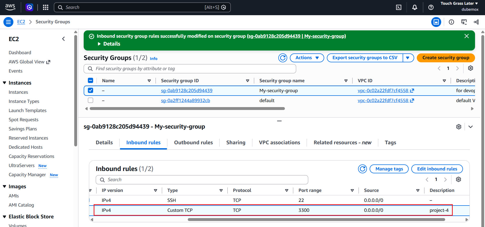

I tested the application in my browser:

```text
http://<public-ip-or-public-dns>:3300
```

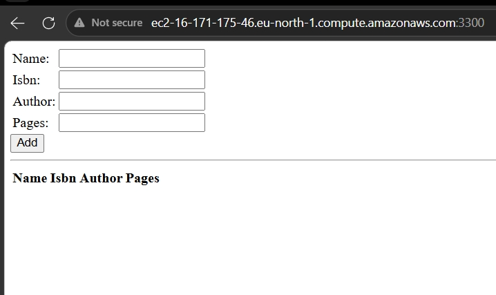

---

## Troubleshooting & Lessons Learned

- Directory location matters: `public` must sit directly inside `Books`, next to `server.js`, so the server can find it.
- This project uses AngularJS (version 1.x), which is a different framework from modern Angular, and AngularJS has reached end of life.

## Cleanup

To avoid unexpected charges and exposure:

- Stop or terminate the EC2 instance when I'm not using it.
- Remove the "allow access from anywhere" rule in MongoDB Atlas, or restrict it to my instance's IP.
- Close port 3300 in the security group when it is no longer needed.

## Author

Dubemox · Lagos, Nigeria.