# Project 5: Implementation of a Client-Server Architecture Using MySQL DBMS

A hands-on project where I learn DevOps by building and running real infrastructure on AWS, and documenting every step along the way.

## Overview

In this project, I implemented a client-server architecture using MySQL. One EC2 instance (`mysql-server`) hosts the MySQL database, and a second EC2 instance (`mysql-client`) connects to it remotely over the network. This mirrors how real applications talk to a separate database server.

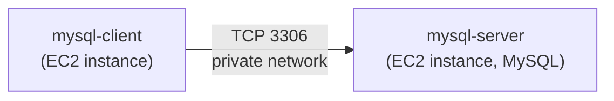

## Goals

- Understand client-server architecture, where a client application or machine sends requests to a separate server that stores and manages the data
- Set up network access between the two instances by configuring the security group to allow traffic on port 3306 from the client only
- Connect from the client to the server remotely and run queries against the server's database

## Environment

| Item | Value |
|------|-------|
| Cloud provider | AWS (free tier) |
| Service | EC2 (two instances: `mysql-server` and `mysql-client`) |
| Region / VPC | `eu-north-1 (Stockholm)`, same VPC for both instances |
| OS | Ubuntu `26.04 LTS` |
| Instance type | `t3.micro` |
| Database | MySQL |
| Connection | SSH from Windows PowerShell |

---

## Step 0: Preparing Prerequisites

I launched two Ubuntu EC2 instances in the same region and VPC, named them `mysql-server` and `mysql-client`, and confirmed that both were running:

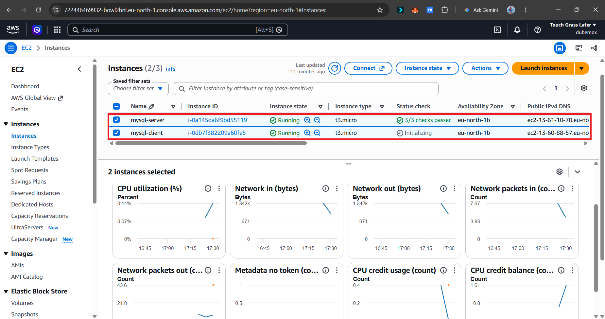

I connected to both instances over SSH:

```powershell
ssh -i "key.pem" ubuntu@<public-ip-or-dns>
```

I verified internet connectivity on each instance:

```bash
curl -Iv www.bing.com
```

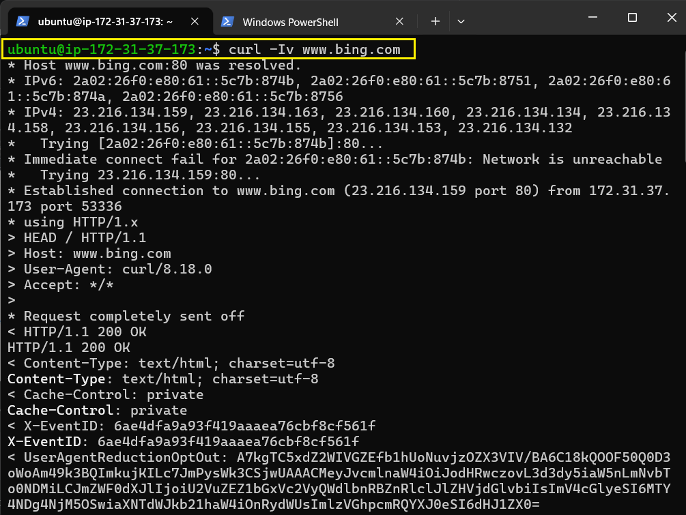

---

## Step 1: Installing MySQL Server on `mysql-server`

```bash
# Update the list of packages
sudo apt update

# Install the MySQL server
sudo apt install mysql-server -y

# Enable MySQL to start on boot, and start it now
sudo systemctl enable --now mysql

# Check the status
sudo systemctl status mysql
```

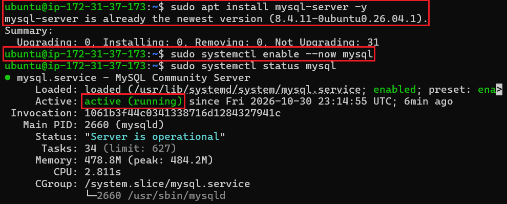

---

## Step 2: Installing the MySQL Client on `mysql-client`

```bash
# Update the list of packages
sudo apt update

# Install the MySQL client
sudo apt install mysql-client -y
```

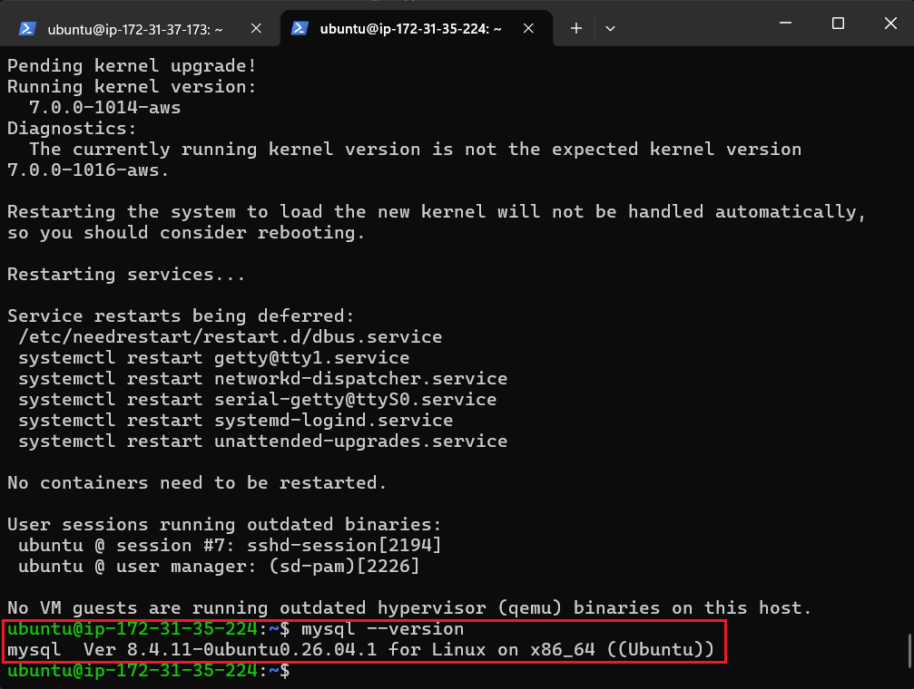

---

## Step 3: Configuring the Security Group on `mysql-server`

I added an inbound rule to the server's security group that allows MySQL traffic (TCP port 3306) **only from the client**, using the client's private IP address as the source (`<client-private-ip>/32`):

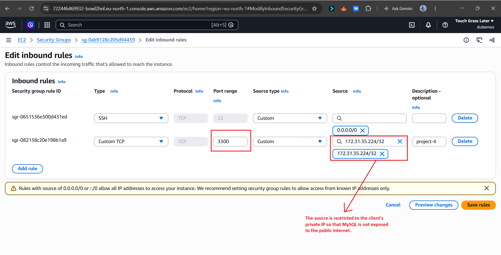

> **Important:** Never open port 3306 to `0.0.0.0/0` (the whole internet).

---

## Step 4: Allowing Remote Connections in MySQL

By default, MySQL only listens for connections from the machine it runs on. I edited the MySQL configuration file on the server:

```bash
sudo vi /etc/mysql/mysql.conf.d/mysqld.cnf
```

I changed:

```ini
bind-address = 127.0.0.1
```

to:

```ini
bind-address = 0.0.0.0
```

I restarted MySQL to apply the change:

```bash
sudo systemctl restart mysql
```

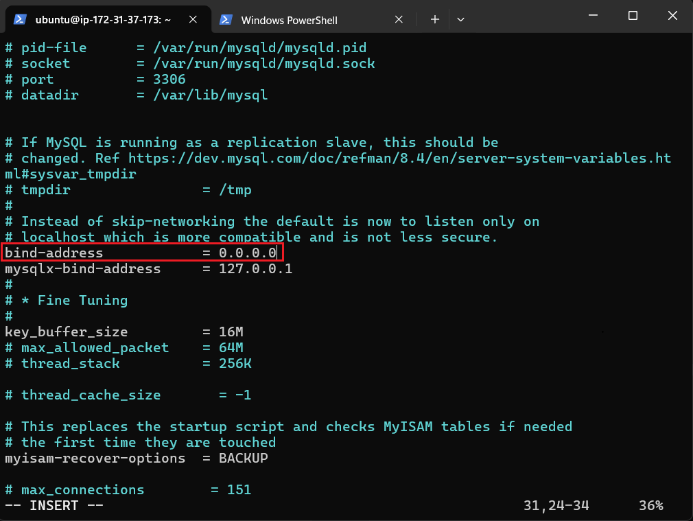

> **Note:** `0.0.0.0` makes MySQL listen on all network interfaces. This is safe here only because the security group allows port 3306 from the client alone. A tighter option is to set `bind-address` to the server's private IP.

---

## Step 5: Creating a Database and a Remote User on `mysql-server`

I opened the MySQL console on the server:

```bash
sudo mysql
```

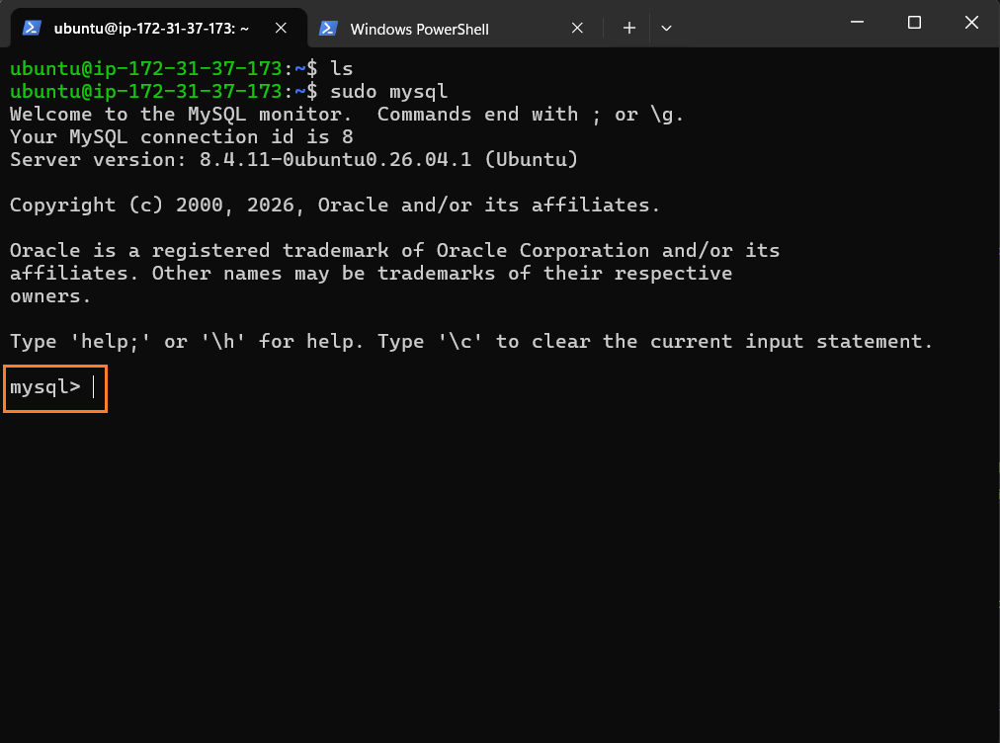

Then I created a database and a user that is allowed to connect only from the client's private IP:

```sql
CREATE DATABASE test_db;
CREATE USER 'test_user'@'<client-private-ip>' IDENTIFIED BY '<your-password>';
GRANT ALL PRIVILEGES ON test_db.* TO 'test_user'@'<client-private-ip>';
FLUSH PRIVILEGES;
```

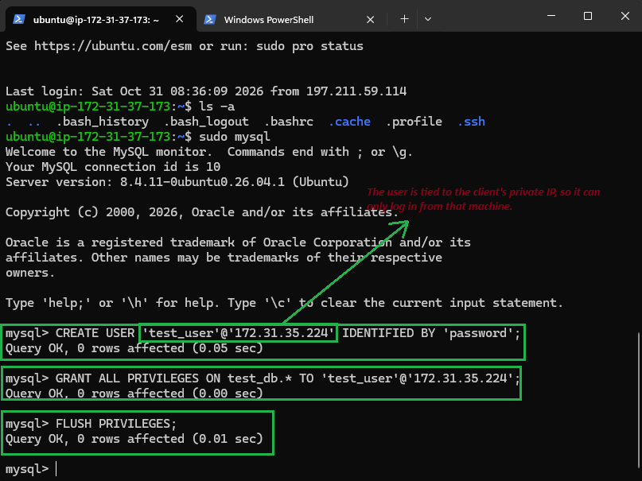

---

## Step 6: Connecting from `mysql-client` to `mysql-server`

From the client, I connected to the server using the server's private IP:

```bash
mysql -u test_user -p -h <server-private-ip>
```

I verified the connection:

```sql
SHOW DATABASES;
```

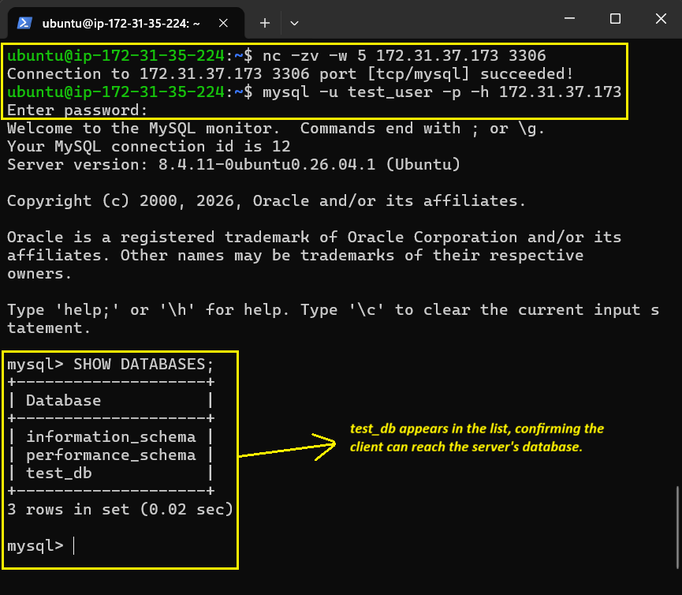

---

## Step 7: Testing Reading and Writing Across the Connection

From the client, I switched to `test_db`, created a table, inserted a row, and read it back:

```sql
USE test_db;
CREATE TABLE students (id INT AUTO_INCREMENT PRIMARY KEY, name VARCHAR(50));
INSERT INTO students (name) VALUES ('Test User');
SELECT * FROM students;
```

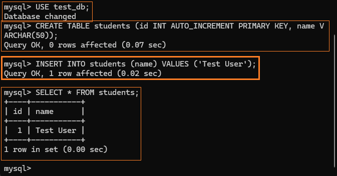

Then, on the server, I confirmed that the same row exists:

```bash
sudo mysql
```

```sql
SELECT * FROM test_db.students;
```

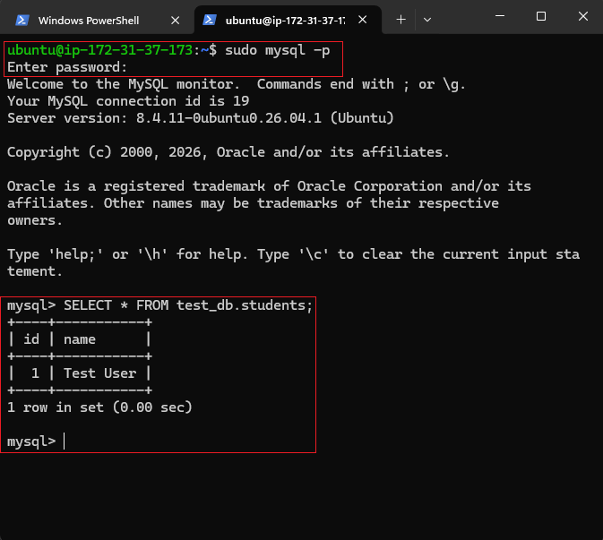

The row written from the client is stored on the server, which confirms that the client-server setup works.

---

## Troubleshooting & Lessons Learned

- If the client can't connect, check these three things: the `bind-address` setting, the security group rule (port 3306 and the client's private IP), and that the MySQL user's host matches the client's IP.

## Cleanup

To avoid unexpected charges, I stop or terminate both EC2 instances when I'm not using them.

## Author

Dubemox · Lagos, Nigeria.