# Project 6: Web Solution with WordPress: Three-Tier Architecture and LVM Storage on Red Hat (AWS)

A hands-on project where I learn DevOps by building and running real infrastructure on AWS, and documenting every step along the way.

## Overview

In this project, I built a three-tier web solution for WordPress on two Red Hat EC2 instances:

1. **Presentation tier:** the user's browser
2. **Application tier:** a web server running Apache, PHP and WordPress
3. **Data tier:** a database server running MariaDB (a MySQL-compatible database)

Both servers use **LVM (Logical Volume Manager)** for storage, which lets several disks be combined and resized flexibly.

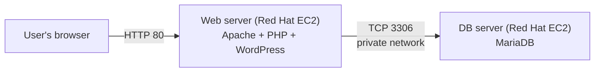

## Goals

- Understand three-tier architecture
- Learn how to manage storage with LVM (partitions, physical volumes, volume groups and logical volumes)
- Install WordPress on a web server and connect it to a remote database server

## LVM Concepts

| Term | Meaning |
|------|---------|
| **PV** (physical volume) | A disk or partition prepared for use by LVM |
| **VG** (volume group) | A pool of storage made by combining one or more PVs |
| **LV** (logical volume) | A flexible "virtual partition" carved out of a VG, which holds a filesystem |

## Environment

| Item | Value |
|------|-------|
| Cloud provider | AWS (free tier) |
| Service | EC2 (two instances: `web-server` and `db-server`) and EBS (six 10 GiB volumes) |
| Region | eu-north-1 |
| OS | Red Hat Enterprise Linux 10.2 (Coughlan) |
| Instance type | t3.micro |
| Connection | SSH from Windows PowerShell |

---

## Step 1: Preparing the Web Server

I launched a Red Hat EC2 instance to serve as the web server. I also created three 10 GiB EBS volumes in the **same Availability Zone** as the instance and attached them to it.

### Inspecting the disks

I used `lsblk` to inspect the block devices attached to the server:

```bash
lsblk
```

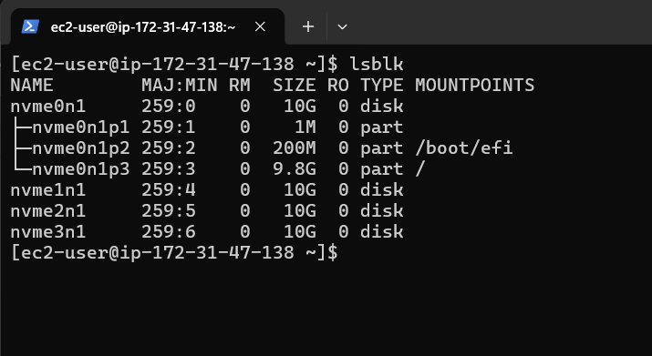

### Creating partitions

I used `fdisk` to create a single partition on each of the three disks (inside `fdisk`: `n` for a new partition, accept the defaults, then `w` to write the changes):

```bash
# Disk 1
sudo fdisk /dev/nvme1n1

# Disk 2
sudo fdisk /dev/nvme2n1

# Disk 3
sudo fdisk /dev/nvme3n1
```

I used `lsblk` again to view the new partition on each disk:

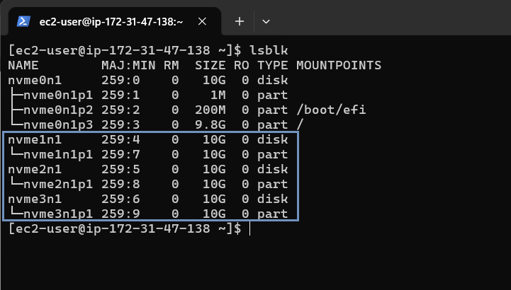

### Creating the physical volumes, volume group and logical volumes

I used `pvcreate` to mark each partition as a physical volume for LVM:

```bash
sudo pvcreate /dev/nvme1n1p1 /dev/nvme2n1p1 /dev/nvme3n1p1
```

I confirmed that the physical volumes were created:

```bash
sudo pvs
```

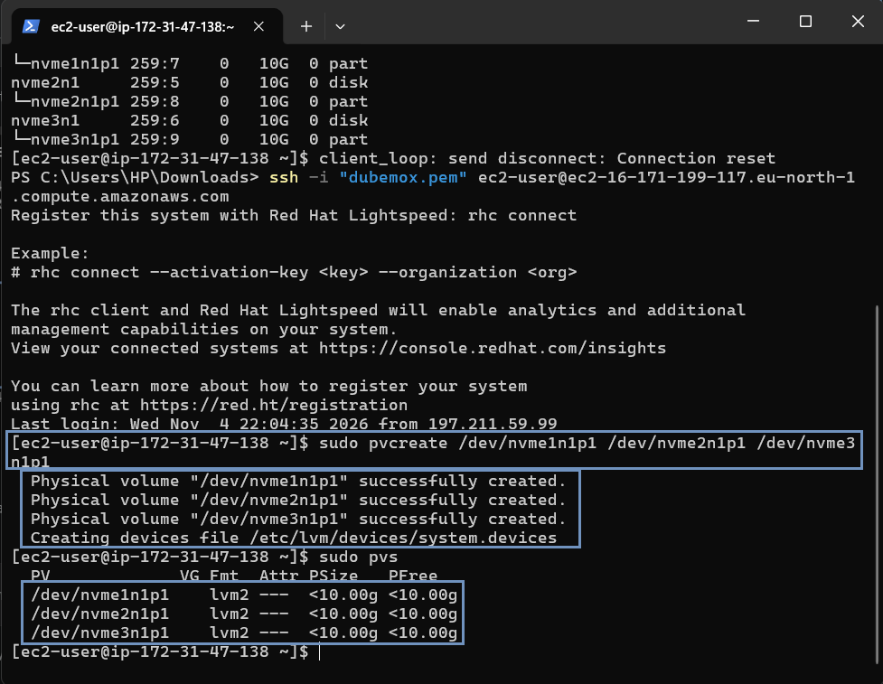

I used `vgcreate` to add all three physical volumes to a volume group named `webdata-vg`:

```bash
sudo vgcreate webdata-vg /dev/nvme1n1p1 /dev/nvme2n1p1 /dev/nvme3n1p1
```

I verified it:

```bash
sudo vgs
```

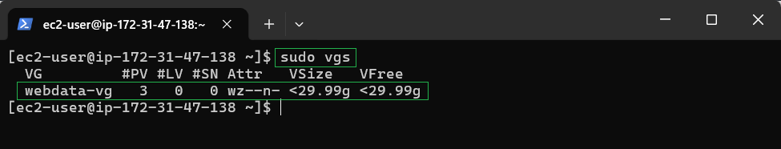

I created two logical volumes, `apps-lv` (for website files) and `logs-lv` (for logs):

```bash
sudo lvcreate -n apps-lv -l 50%VG webdata-vg
sudo lvcreate -n logs-lv -l 100%FREE webdata-vg
```

I verified the logical volumes:

```bash
sudo lvs
```

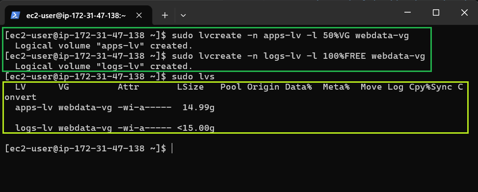

The full setup:

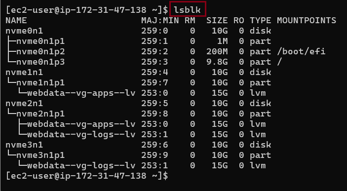

### Formatting and mounting

I formatted the logical volumes with the `ext4` filesystem:

```bash
sudo mkfs -t ext4 /dev/webdata-vg/apps-lv
sudo mkfs -t ext4 /dev/webdata-vg/logs-lv
```

I created the `/var/www/html` directory (for website files) and the `/home/recovery/logs` directory (to back up the existing log data):

```bash
sudo mkdir -p /var/www/html
sudo mkdir -p /home/recovery/logs
```

I mounted `/var/www/html` on the `apps-lv` logical volume:

```bash
sudo mount /dev/webdata-vg/apps-lv /var/www/html/
```

Mounting a volume on `/var/log` hides the files already there, so I first used `rsync` to back up everything in `/var/log`:

```bash
sudo rsync -av /var/log/. /home/recovery/logs/
```

I mounted `/var/log` on the `logs-lv` logical volume:

```bash
sudo mount /dev/webdata-vg/logs-lv /var/log
```

I restored the log files into `/var/log`:

```bash
sudo rsync -av /home/recovery/logs/. /var/log
```

### Making the mounts persistent

I updated `/etc/fstab` so the mounts survive a restart. First I looked up the UUIDs of the two logical volumes, then edited the file:

```bash
# Get the UUIDs of the two logical volumes
sudo blkid /dev/webdata-vg/apps-lv /dev/webdata-vg/logs-lv

# Edit fstab
sudo vi /etc/fstab
```

I added one line per volume, using my own UUIDs:

```text
UUID=<apps-lv-uuid>  /var/www/html  ext4  defaults  0 0
UUID=<logs-lv-uuid>  /var/log       ext4  defaults  0 0
```

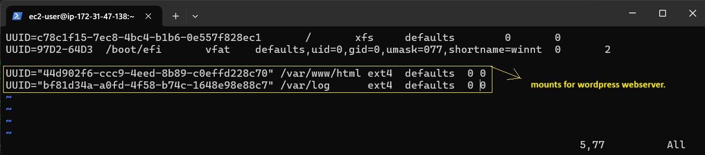

I tested the configuration, reloaded the daemon, and checked the result:

```bash
sudo mount -a
sudo systemctl daemon-reload
df -h
```

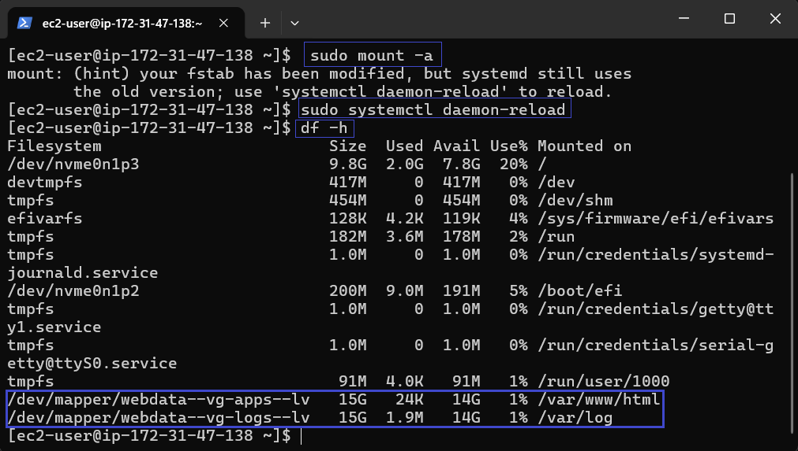

---

## Step 2: Preparing the Database Server

I launched a second Red Hat EC2 instance to serve as the database server. I created three 10 GiB EBS volumes in the **same Availability Zone** as this instance and attached them to it.

I used `lsblk` to inspect the block devices attached to the `db-server`:

```bash
lsblk
```

I used `fdisk` to create a single partition on each of the three disks, then viewed the result:

```bash
# Disk 1
sudo fdisk /dev/nvme1n1

# Disk 2
sudo fdisk /dev/nvme2n1

# Disk 3
sudo fdisk /dev/nvme3n1

# View the new partition on each disk
lsblk
```

I marked the partitions as physical volumes and confirmed them:

```bash
# Create the physical volumes
sudo pvcreate /dev/nvme1n1p1 /dev/nvme2n1p1 /dev/nvme3n1p1

# Confirm
sudo pvs
```

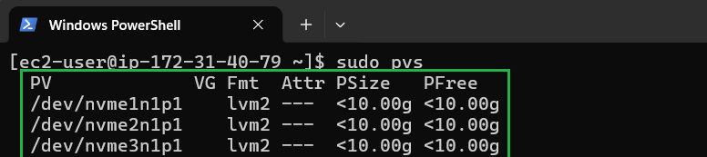

I added all three physical volumes to a volume group named `db-vg`:

```bash
sudo vgcreate db-vg /dev/nvme1n1p1 /dev/nvme2n1p1 /dev/nvme3n1p1
```

I verified it:

```bash
sudo vgs
```

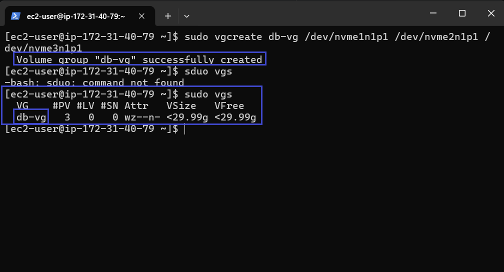

I created two logical volumes, `db-lv` (for database files) and `logs-lv` (for logs):

```bash
sudo lvcreate -n db-lv -l 50%VG db-vg
sudo lvcreate -n logs-lv -l 100%FREE db-vg
```

I verified the logical volumes:

```bash
sudo lvs
```

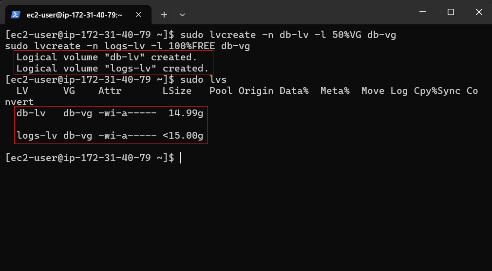

The full setup:

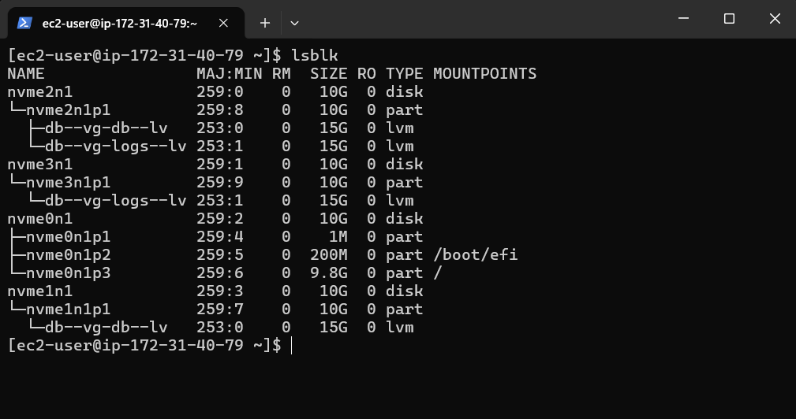

I formatted the logical volumes with the `ext4` filesystem:

```bash
sudo mkfs -t ext4 /dev/db-vg/db-lv
sudo mkfs -t ext4 /dev/db-vg/logs-lv
```

I created the `/db` directory (for database files) and the `/home/recovery/logs` directory (to back up the existing log data):

```bash
sudo mkdir -p /db
sudo mkdir -p /home/recovery/logs
```

I mounted `/db` on the `db-lv` logical volume:

```bash
sudo mount /dev/db-vg/db-lv /db
```

I backed up everything in `/var/log`:

```bash
sudo rsync -av /var/log/. /home/recovery/logs/
```

I mounted `/var/log` on the `logs-lv` logical volume:

```bash
sudo mount /dev/db-vg/logs-lv /var/log
```

I restored the log files into `/var/log`:

```bash
sudo rsync -av /home/recovery/logs/. /var/log
```

I updated `/etc/fstab` so the mounts survive a restart:

```bash
# Get the UUIDs of the two logical volumes
sudo blkid /dev/db-vg/db-lv /dev/db-vg/logs-lv

# Edit fstab
sudo vi /etc/fstab
```

```text
UUID=<db-lv-uuid>    /db       ext4  defaults  0 0
UUID=<logs-lv-uuid>  /var/log  ext4  defaults  0 0
```

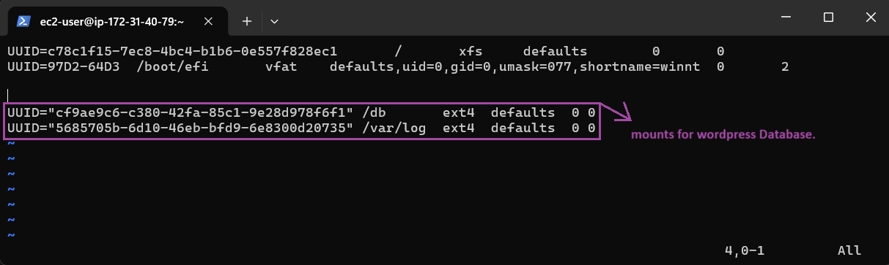

I tested the configuration, reloaded the daemon, and checked the result:

```bash
sudo mount -a
sudo systemctl daemon-reload
df -h
```

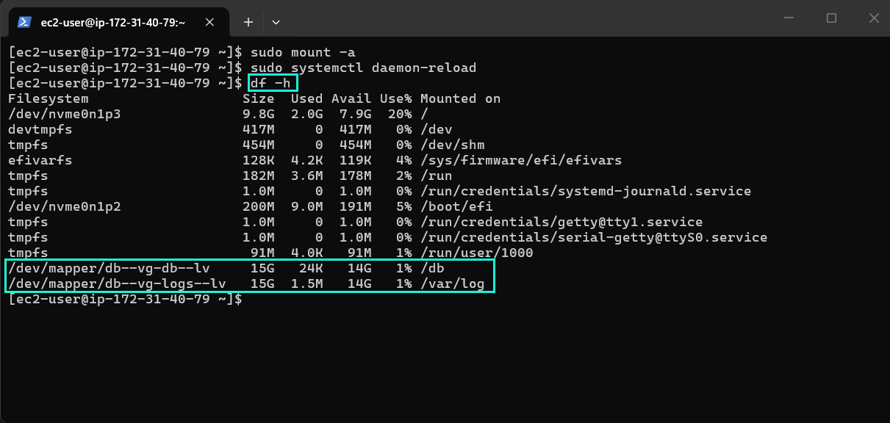

---

## Step 3: Installing WordPress on the Web Server

I updated the packages, then installed `wget`, Apache and PHP with their dependencies:

```bash
# Update
sudo yum -y update

# Install wget, Apache and PHP with its dependencies
sudo yum -y install wget httpd php php-mysqlnd php-fpm php-json

# Enable and start Apache
sudo systemctl enable httpd
sudo systemctl start httpd
```

I installed additional PHP packages from the Remi repository:

```bash
sudo yum install https://dl.fedoraproject.org/pub/epel/epel-release-latest8.noarch.rpm
sudo yum install yum-utils http://rpms.remirepo.net/enterprise/remi-release8.rpm
sudo yum module list php
sudo yum module reset php
sudo yum module enable php:remi-7.4
sudo yum install php php-opcache php-gd php-curl php-mysqlnd
sudo systemctl start php-fpm
sudo systemctl enable php-fpm
sudo setsebool -P httpd_execmem 1

# Restart Apache
sudo systemctl restart httpd
```

I downloaded WordPress, extracted it, created its configuration file from the sample, and copied everything to `/var/www/html`:

```bash
mkdir wordpress
cd wordpress
sudo wget https://wordpress.org/latest.tar.gz
sudo tar xzvf latest.tar.gz
sudo rm -rf latest.tar.gz
sudo cp wordpress/wp-config-sample.php wordpress/wp-config.php
sudo cp -R wordpress /var/www/html/
```

I configured ownership and SELinux policies so Apache can use the files and reach the database:

```bash
sudo chown -R apache:apache /var/www/html/wordpress
sudo chcon -t httpd_sys_rw_content_t /var/www/html/wordpress -R
sudo setsebool -P httpd_can_network_connect=1
sudo setsebool -P httpd_can_network_connect_db=1
```

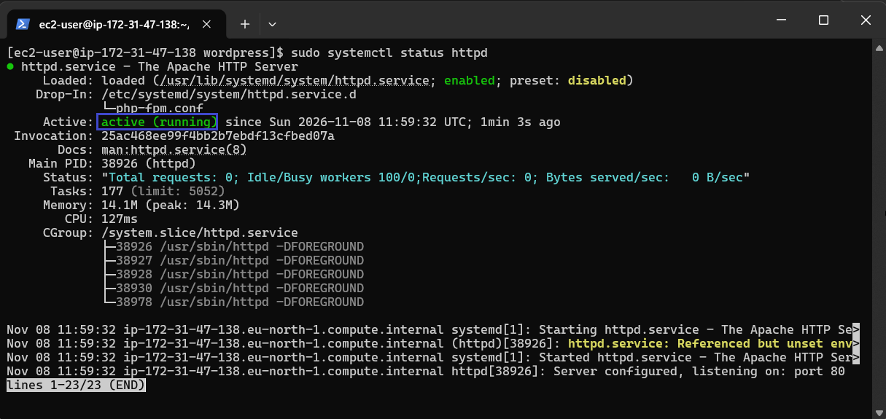

---

## Step 4: Installing the Database Software on the DB Server

Red Hat provides MariaDB, a MySQL-compatible database. I installed and started it on the `db-server`:

```bash
# Update
sudo yum -y update

# Install MariaDB
sudo dnf -y install mariadb-server

# Restart, enable and check the service
sudo systemctl restart mariadb
sudo systemctl enable --now mariadb
sudo systemctl status mariadb
```

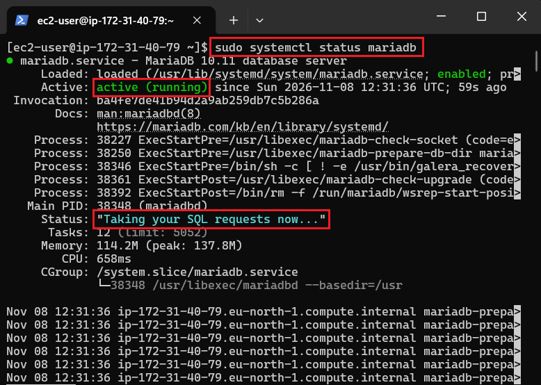

---

## Step 5: Configuring the Database to Work with WordPress

### Creating the database and user

On the `db-server`, I opened the database console:

```bash
sudo mysql
```

Then I created a database for WordPress and a user that can connect only from the web server's private IP:

```sql
CREATE DATABASE wordpress;
CREATE USER 'myuser'@'<web-server-private-IP>' IDENTIFIED BY '<my-password>';
GRANT ALL ON wordpress.* TO 'myuser'@'<web-server-private-IP>';
FLUSH PRIVILEGES;
SHOW DATABASES;
exit
```

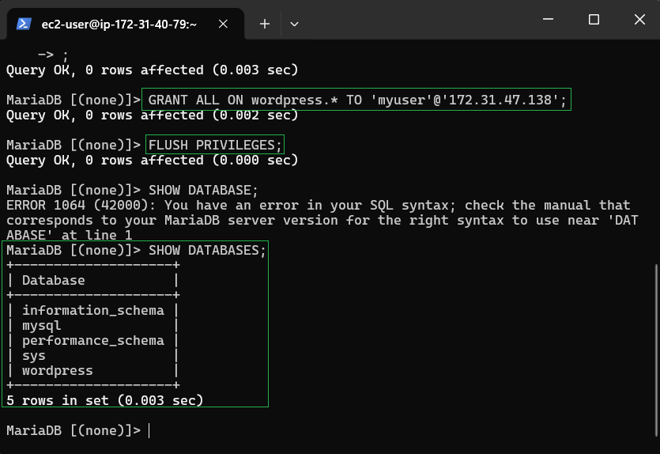

### Allowing the web server to reach the database

I added an inbound rule to the `db-server`'s security group that allows MySQL traffic (TCP port 3306) only from the web server's private IP:

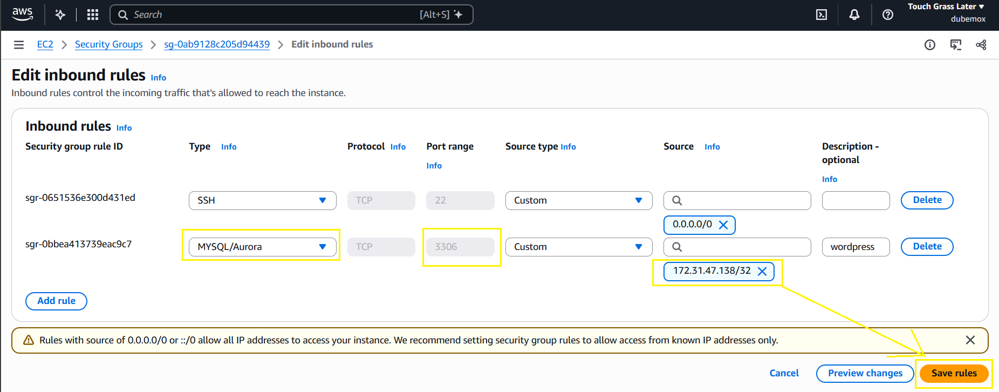

### Testing the connection

From the `web-server`, I installed the MariaDB client and tested the connection to the `db-server`:

```bash
sudo dnf -y install mariadb
mysql -u myuser -p -h <db-server-private-IP>
```

```sql
SHOW DATABASES;
```

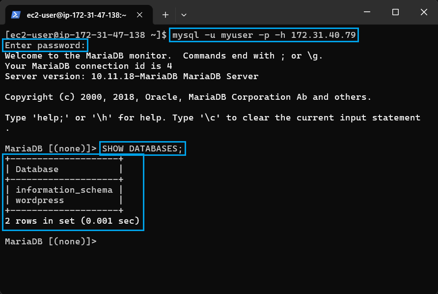

### Pointing WordPress at the database

On the `web-server`, I edited WordPress's configuration file so it uses the remote database:

```bash
sudo vi /var/www/html/wordpress/wp-config.php
```

```php
define( 'DB_NAME', 'wordpress' );
define( 'DB_USER', 'myuser' );
define( 'DB_PASSWORD', '<my-password>' );
define( 'DB_HOST', '<db-server-private-IP>' );
```

### Opening the website to the internet

I added an inbound rule for TCP port 80 to the `web-server`'s security group:

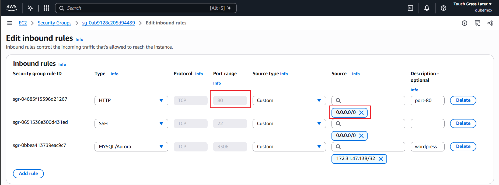

I confirmed that WordPress works by opening it in my browser:

```text
http://<web-server-public-ip>/wordpress
```

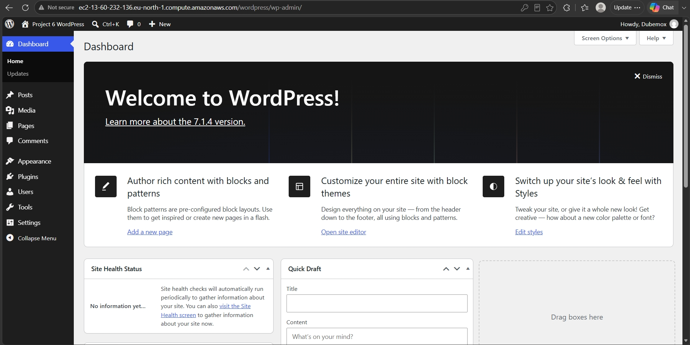

---

## Troubleshooting & Lessons Learned

- Check the order of operations when mounting over `/var/log`: back up the logs first, mount the new volume, then restore them.
- If WordPress can't connect to the database, check the security group rule (port 3306 and the web server's private IP), the MySQL user's host, and the SELinux settings (`httpd_can_network_connect_db`).

## Cleanup

To avoid unexpected charges:

- Stop or terminate both EC2 instances when I'm not using them.
- Delete the six 10 GiB EBS volumes if I no longer need them. Volumes keep costing money even when instances are stopped.

## Author

Dubemox · Lagos, Nigeria.