# Project 7: DevOps Tooling Website Solution: Three-Tier Web Application Architecture with a Single Database and an NFS Server for Shared File Storage

A hands-on project where I learn DevOps by building and running real infrastructure on AWS, and documenting every step along the way.

## Overview

In this project, I built a three-tier web application:

1. **Presentation tier:** the user's browser
2. **Application tier:** one or more web servers running Apache and PHP
3. **Data tier:** a single MySQL database server, plus an NFS server that provides shared file storage

The web servers don't keep their own copy of the website files or logs. They mount shared storage from the NFS server, so every web server serves the same content.

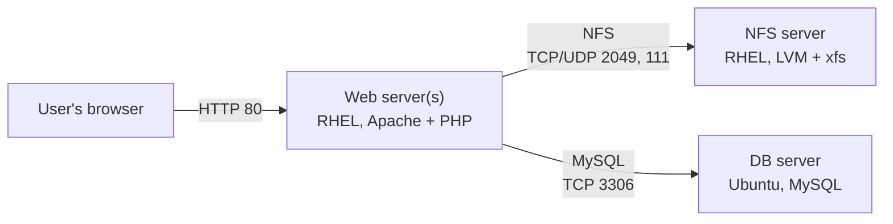

## Goals

- Set up shared file storage with NFS (Network File System) on top of LVM
- Mount shared storage on a web server
- Connect a web application to a separate MySQL database server
- Deploy a PHP application (the Tooling website) from GitHub

## Environment

| Item | Value |
|------|-------|
| Cloud provider | AWS (free tier) |
| Region | eu-north-1` |
| NFS server | Red Hat Enterprise Linux 9, three 10 GiB EBS volumes |
| Web server | Red Hat Enterprise Linux 10.2 (coughlan) |
| DB server | Ubuntu 26.04 LTS, MySQL |
| Instance type | t3.micro |
| Connection | SSH from Windows PowerShell |

---

## Step 1: Preparing the NFS Server

I launched a new EC2 instance running Red Hat Enterprise Linux (RHEL) to serve as the NFS server:

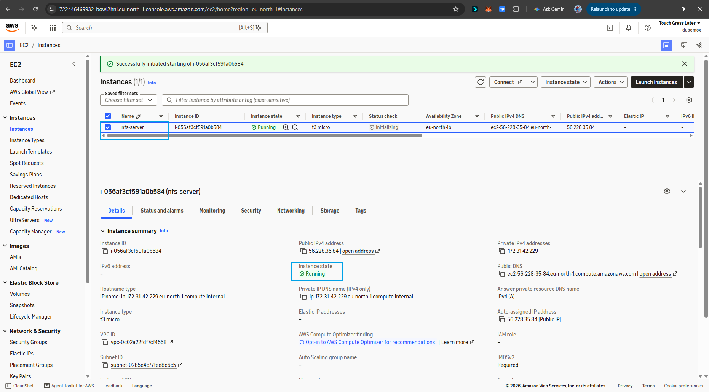

I created three 10 GiB EBS volumes in the same Availability Zone as the instance and attached them to it:

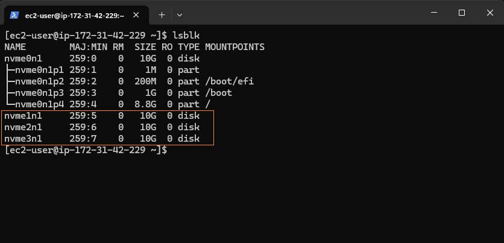

### Partitioning the disks

I created a single partition on each disk (inside `fdisk`: `n` for a new partition, accept the defaults, then `w` to write the changes):

```bash
sudo fdisk /dev/nvme1n1
sudo fdisk /dev/nvme2n1
sudo fdisk /dev/nvme3n1
```

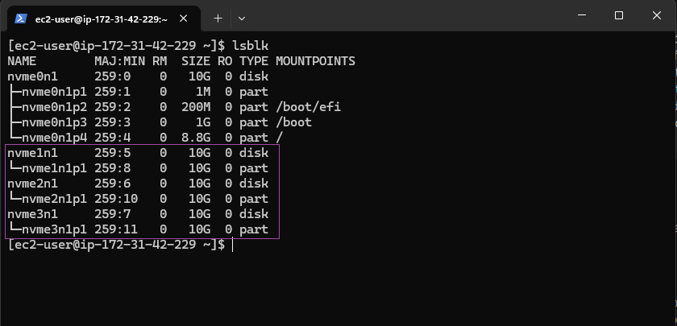

### Creating the LVM layers

I created the physical volumes, a volume group named `webdata-vg`, and three logical volumes:

```bash
# Physical volumes
sudo pvcreate /dev/nvme1n1p1 /dev/nvme2n1p1 /dev/nvme3n1p1
sudo pvs

# Volume group
sudo vgcreate webdata-vg /dev/nvme1n1p1 /dev/nvme2n1p1 /dev/nvme3n1p1
sudo vgs

# Logical volumes
sudo lvcreate -n lv-opt  -L 9G webdata-vg
sudo lvcreate -n lv-apps -L 9G webdata-vg
sudo lvcreate -n lv-logs -l 100%FREE webdata-vg
sudo lvs
```

| Logical volume | Purpose |
|----------------|---------|
| `lv-apps` | Website files, shared with the web servers |
| `lv-logs` | Web server logs, shared with the web servers |
| `lv-opt` | Reserved for the Jenkins server in a later project |

### Formatting and mounting

I formatted the logical volumes with the `xfs` filesystem:

```bash
sudo mkfs -t xfs /dev/webdata-vg/lv-opt
sudo mkfs -t xfs /dev/webdata-vg/lv-apps
sudo mkfs -t xfs /dev/webdata-vg/lv-logs
sudo lsblk -f
```

I created the mount points and mounted the volumes:

```bash
sudo mkdir -p /mnt/apps /mnt/logs /mnt/opt
sudo mount /dev/webdata-vg/lv-apps /mnt/apps
sudo mount /dev/webdata-vg/lv-logs /mnt/logs
sudo mount /dev/webdata-vg/lv-opt  /mnt/opt
```

### Making the mounts persistent

I looked up the UUIDs of the logical volumes and added them to `/etc/fstab`:

```bash
sudo blkid /dev/webdata-vg/lv-apps /dev/webdata-vg/lv-logs /dev/webdata-vg/lv-opt
sudo vi /etc/fstab
```

```text
UUID=<lv-apps-uuid>  /mnt/apps  xfs  defaults  0 0
UUID=<lv-logs-uuid>  /mnt/logs  xfs  defaults  0 0
UUID=<lv-opt-uuid>   /mnt/opt   xfs  defaults  0 0
```

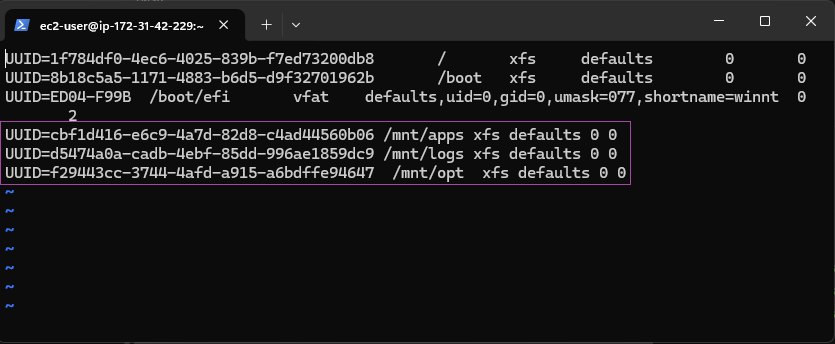

### Installing the NFS server

I updated the system, installed the NFS server, and configured it to start on reboot:

```bash
sudo yum -y update
sudo yum install -y nfs-utils
sudo systemctl start nfs-server.service
sudo systemctl enable nfs-server.service
sudo systemctl status nfs-server.service
```

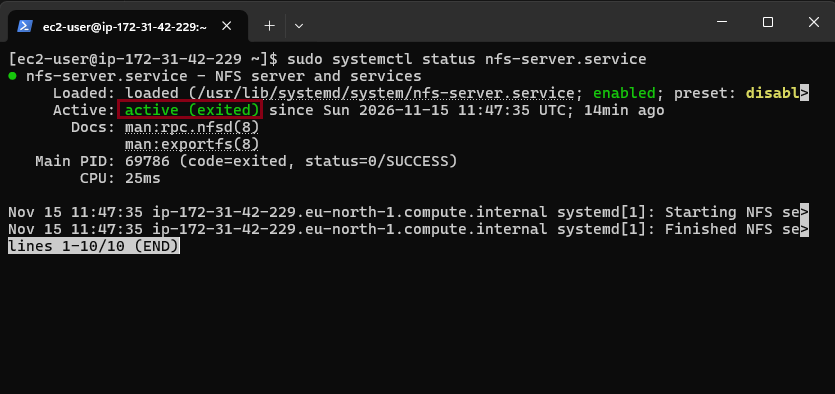

### Setting ownership and permissions

```bash
sudo chown -R nobody: /mnt/apps /mnt/logs /mnt/opt
sudo chmod -R 777 /mnt/apps /mnt/logs /mnt/opt
sudo systemctl restart nfs-server.service
```

> **Note:** `777` makes these directories writable by everyone. That is fine for a lab, but not for production.

### Configuring the exports

I edited `/etc/exports` to share the volumes with the web servers' subnet (for example `172.31.32.0/20`):

```bash
sudo vi /etc/exports
```

```text
/mnt/apps <web-subnet-cidr>(rw,sync,no_all_squash,no_root_squash)
/mnt/logs <web-subnet-cidr>(rw,sync,no_all_squash,no_root_squash)
/mnt/opt  <web-subnet-cidr>(rw,sync,no_all_squash,no_root_squash)
```

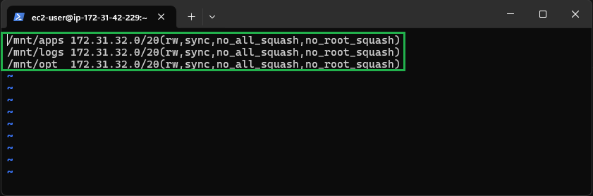

I applied the exports:

```bash
sudo exportfs -arv
```

### Opening the NFS ports

I added an inbound rule to the NFS server's security group for TCP 111, UDP 111, TCP 2049 and UDP 2049, with the web servers' subnet as the source:

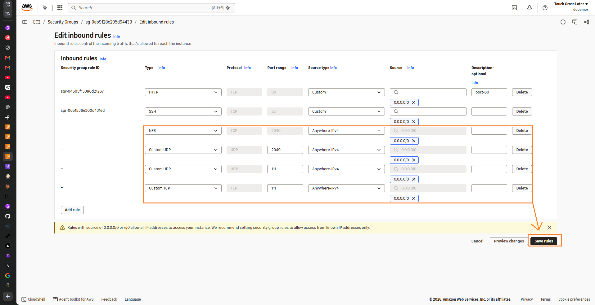

> **Important:** Never open NFS ports to `0.0.0.0/0` (the whole internet).

---

## Step 2: Configuring the Database Server

I launched a new Ubuntu EC2 instance to serve as the DB server and installed MySQL:

```bash
sudo apt update
sudo apt install -y mysql-server
sudo systemctl status mysql
```

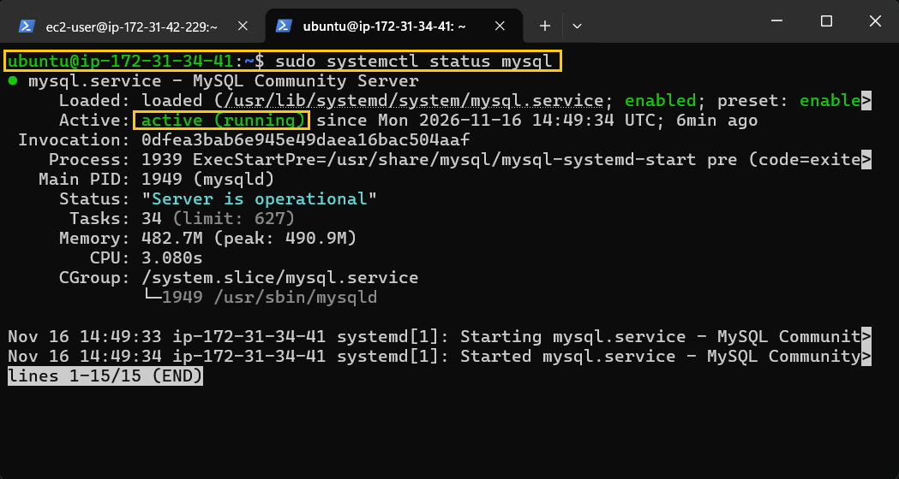

I created a database and a user that can connect only from the web servers' subnet:

```bash
sudo mysql
```

```sql
CREATE DATABASE tooling;
CREATE USER 'webaccess'@'<web-subnet-address>/<netmask>' IDENTIFIED BY '<your-password>';
GRANT ALL PRIVILEGES ON tooling.* TO 'webaccess'@'<web-subnet-address>/<netmask>';
FLUSH PRIVILEGES;
SHOW DATABASES;
exit
```

> **Note:** MySQL account hosts use the network/netmask format, not CIDR. For example, the subnet `172.31.32.0/20` is written `172.31.32.0/255.255.240.0`.

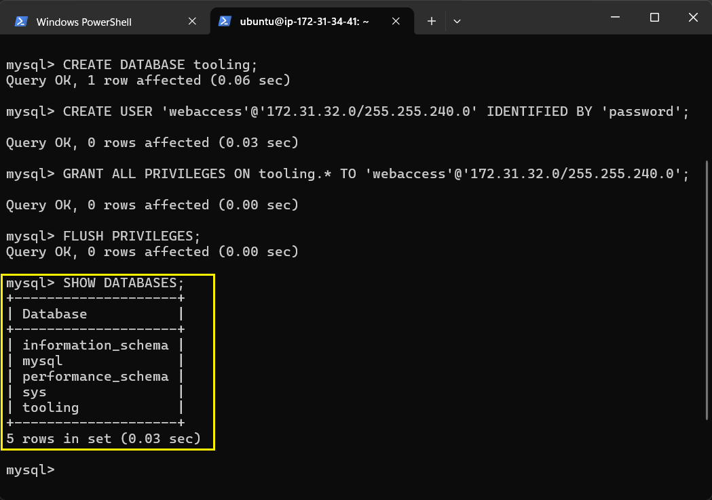

I configured MySQL to accept remote connections by editing its configuration file:

```bash
sudo vi /etc/mysql/mysql.conf.d/mysqld.cnf
```

I changed:

```ini
bind-address = 127.0.0.1
```

to:

```ini
bind-address = 0.0.0.0
```

I restarted MySQL for the change to take effect:

```bash
sudo systemctl restart mysql
```

I also added an inbound rule to the DB server's security group that allows TCP port 3306 only from the web servers' subnet.

---

## Step 3: Preparing the Web Server

I launched a new RHEL EC2 instance to serve as the web server.

### Mounting the shared website files

I installed the NFS client and mounted the NFS server's `/mnt/apps` on `/var/www`:

```bash
sudo yum install -y nfs-utils nfs4-acl-tools
sudo mkdir -p /var/www
sudo mount -t nfs -o rw,nosuid <NFS-private-IP>:/mnt/apps /var/www
df -h
```

I made the mount persistent by adding it to `/etc/fstab`:

```bash
sudo vi /etc/fstab
```

```text
<NFS-private-IP>:/mnt/apps /var/www nfs defaults 0 0
```

```bash
sudo mount -a
```

### Installing Apache and PHP

```bash
sudo yum install -y httpd
sudo dnf module reset php -y
sudo dnf module enable php:7.4 -y
sudo yum install -y php php-opcache php-gd php-curl php-mysqlnd php-fpm
sudo systemctl enable --now httpd php-fpm
sudo setsebool -P httpd_execmem 1
```


### Configuring SELinux

I allowed Apache to use NFS storage and to connect to a database:

```bash
sudo setsebool -P httpd_use_nfs=1
sudo setsebool -P httpd_can_network_connect_db=1
```

### Mounting Apache's log folder on NFS

I backed up the existing Apache logs, mounted the NFS `/mnt/logs` share on `/var/log/httpd`, restored the logs, and made the mount persistent:

```bash
sudo mkdir -p /home/recovery/httpd
sudo rsync -av /var/log/httpd/. /home/recovery/httpd/
sudo mount -t nfs -o rw,nosuid <NFS-private-IP>:/mnt/logs /var/log/httpd
sudo rsync -av /home/recovery/httpd/. /var/log/httpd/
echo '<NFS-private-IP>:/mnt/logs /var/log/httpd nfs defaults 0 0' | sudo tee -a /etc/fstab
sudo mount -a
sudo systemctl restart httpd
df -h
```

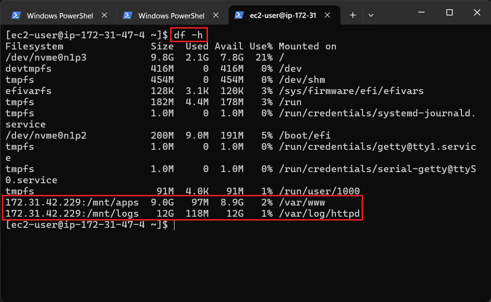

---

## Step 4: Deploying the Tooling Website

I installed Git, cloned the tooling code, and copied the website files into the web root (which is the shared NFS storage):

```bash
sudo yum install -y git
git clone https://github.com/<your-github-username>/tooling.git
sudo cp -R tooling/html/. /var/www/html/
ls /var/www/html
```

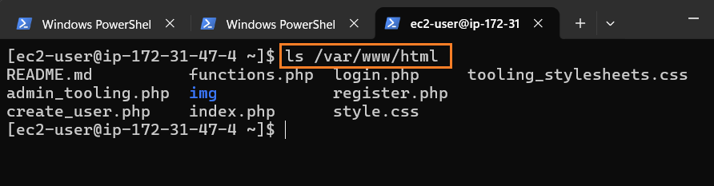

I updated the website's configuration so it connects to the database. First I found the line to change:

```bash
grep -n mysqli_connect /var/www/html/functions.php
sudo vi /var/www/html/functions.php
```

```php
$db = mysqli_connect('<DB-private-IP>', 'webaccess', '<password>', 'tooling');
```

I installed the MySQL client and loaded the database schema from the repository:

```bash
sudo yum install -y mysql
mysql -h <DB-private-IP> -u webaccess -p tooling < ~/tooling/tooling-db.sql
```

I created an admin user. The application stores passwords as MD5 hashes, so I generated one for my chosen password:

```bash
echo -n '<your-password>' | md5sum
```

```bash
mysql -h <DB-private-IP> -u webaccess -p tooling
```

```sql
SELECT * FROM users;
INSERT INTO users (id, username, password, email, user_type, status)
VALUES (2, 'myuser', '<md5-hash-of-your-password>', 'user@mail.com', 'admin', '1');
exit
```

> **Note:** MD5 is not a secure way to store passwords, so this is for the lab only. Never reuse a real password.

I opened the website in my browser:

```text
http://<web-server-public-ip>/index.php
```

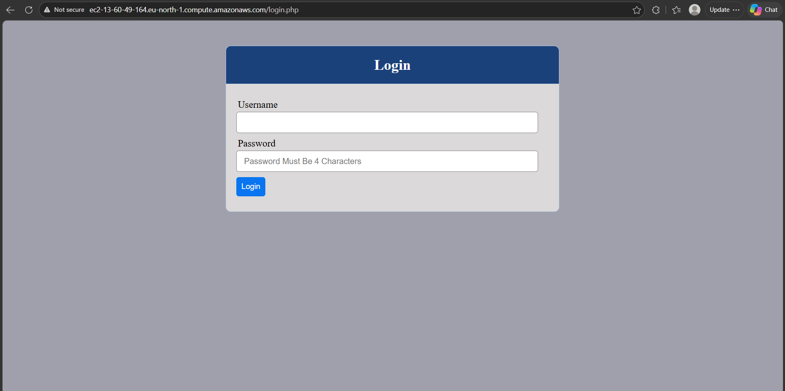

---

## Troubleshooting & Lessons Learned

- If the web server can't mount the NFS share (connection timed out or permission denied), check the NFS server's security group rule (ports 111 and 2049), the `/etc/exports` entry, and that `nfs-server` is running.
- If the website can't reach the database, check the DB server's security group (port 3306), `bind-address`, the MySQL user's host, and the SELinux setting `httpd_can_network_connect_db`.

## Cleanup

To avoid unexpected charges:

- Stop or terminate all the EC2 instances when I'm not using them.
- Delete the three EBS volumes if I no longer need them. Volumes keep costing money even when instances are stopped.

## Author

Dubemox · Lagos, Nigeria.