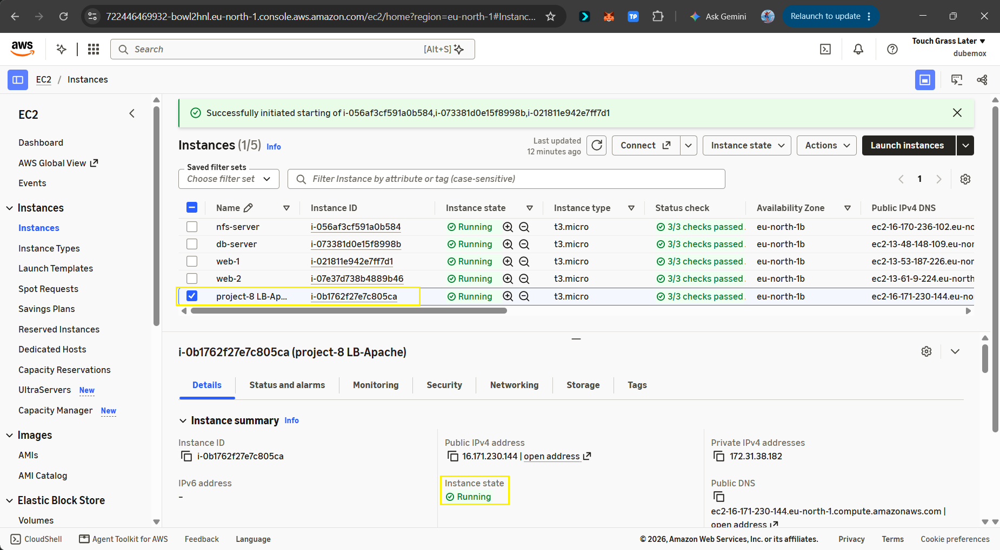
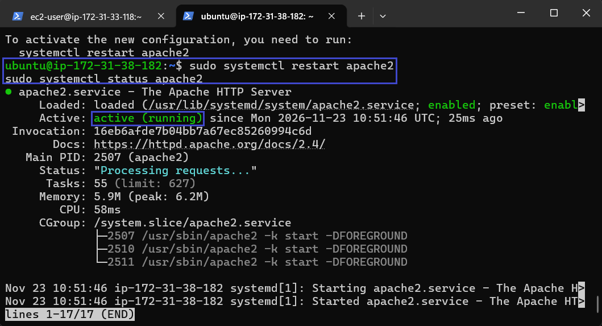
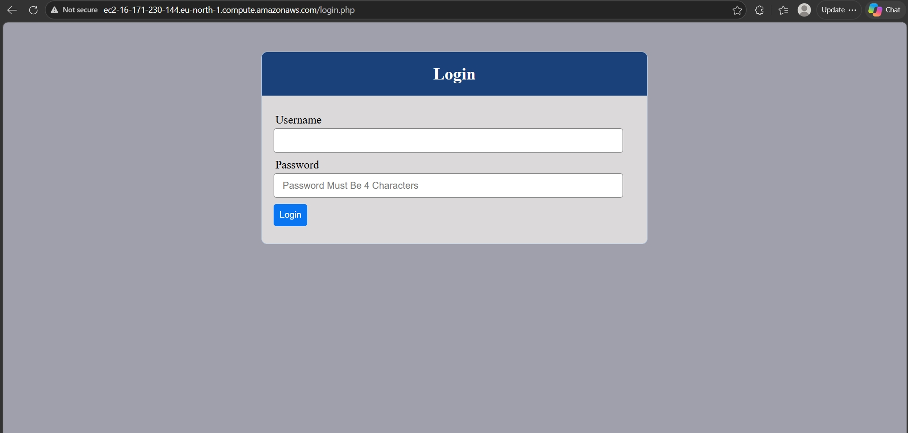
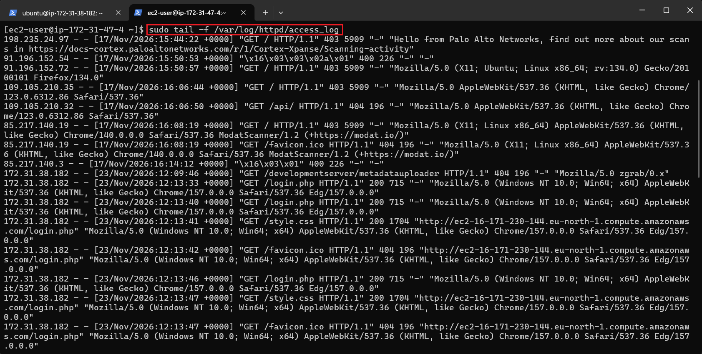
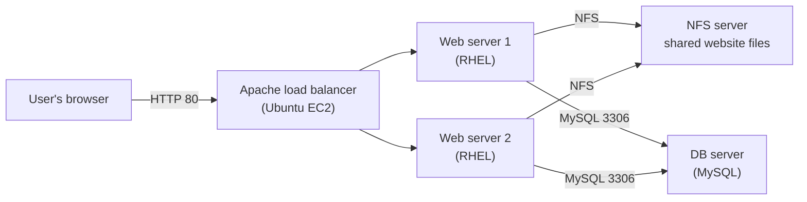

# Project 8: Load Balancer Solution with Apache

A hands-on project where I learn DevOps by building and running real infrastructure on AWS, and documenting every step along the way.

## Overview

In this project, I put an Apache load balancer in front of the two web servers from [Project 7](https://github.com/Dubemox/Devops-Projects/tree/main/project-7). The load balancer receives all incoming requests and spreads them across the web servers, so no single server carries all the traffic, and the site stays available if one server goes down.

## Goals

- Understand what a load balancer does and why it is used
- Configure Apache as a load balancer
- Verify that requests are distributed across both web servers

## Environment

| Item | Value |
|------|-------|
| Cloud provider | AWS (free tier) |
| Region | eu-north-1 |
| Load balancer | Ubuntu 26.04 LTS, EC2 instance running Apache |
| Web servers | Two RHEL EC2 instances from Project 7 |
| Instance type | t3.micro |
| Connection | SSH from Windows PowerShell |

---

## Step 1: Configuring Apache as a Load Balancer

### Launching the load balancer instance

I launched an Ubuntu EC2 instance to act as the load balancer:



I added an inbound rule for TCP port 80 to its security group so users can reach it.

### Installing Apache and enabling the modules

```bash
sudo apt update
sudo apt install -y apache2 libxml2-dev
sudo a2enmod rewrite proxy proxy_balancer proxy_http headers lbmethod_bytraffic
sudo systemctl restart apache2
sudo systemctl status apache2
```



The `proxy`, `proxy_http` and `proxy_balancer` modules let Apache forward requests to other servers, and `lbmethod_bytraffic` provides the load balancing method.

### Configuring load balancing

I edited the default virtual host configuration file:

```bash
sudo vi /etc/apache2/sites-available/000-default.conf
```

Inside the existing `<VirtualHost *:80>` block, I added:

```apache
<Proxy "balancer://mycluster">
    BalancerMember http://<WebServer1-Private-IP>:80 loadfactor=5 timeout=1
    BalancerMember http://<WebServer2-Private-IP>:80 loadfactor=5 timeout=1
    ProxySet lbmethod=bytraffic
    # ProxySet lbmethod=byrequests
</Proxy>

ProxyPreserveHost On
ProxyPass / balancer://mycluster/
ProxyPassReverse / balancer://mycluster/
```

| Setting | Meaning |
|---------|---------|
| `BalancerMember` | A web server that receives traffic from the load balancer |
| `loadfactor=5` | The weight of each server. Equal weights mean an equal share of the traffic |
| `lbmethod=bytraffic` | Distributes requests according to the amount of traffic each server has handled |
| `lbmethod=byrequests` | Alternative: distributes requests according to the number of requests (it needs the `lbmethod_byrequests` module enabled) |

I tested the configuration for syntax errors and restarted Apache:

```bash
sudo apache2ctl configtest
sudo systemctl restart apache2
```

### Verifying the configuration

I opened the load balancer's public address in my browser:

```text
http://<LB-public-IP>/index.php
```



---

## Step 2: Unmounting the Shared Logs on the Web Servers

In Project 7, both web servers shared one NFS folder for `/var/log/httpd`. With a load balancer, each web server should keep its own logs, so I can see which server handled which request. I ran the following on **each** web server.

I stopped Apache and unmounted the shared log folder:

```bash
sudo systemctl stop httpd
sudo umount /var/log/httpd
```

I removed the `/var/log/httpd` line from `/etc/fstab`, so it doesn't remount after a reboot. The `sed` command saves a backup copy as `/etc/fstab.bak`:

```bash
sudo sed -i.bak '\|/var/log/httpd|d' /etc/fstab
grep -n nfs /etc/fstab
```

Only the `/var/www` NFS mount should remain in the output.

I started Apache again and checked that the logs are now local:

```bash
# Start Apache again
sudo systemctl start httpd

# Should print nothing, because the NFS share is no longer mounted here
df -h | grep httpd

# Local log files
ls -l /var/log/httpd
```

---

## Step 3: Verifying That Traffic Is Balanced

On each web server, I watched the Apache access log:

```bash
sudo tail -f /var/log/httpd/access_log
```

Then I refreshed the load balancer's address in my browser several times. New `GET` requests appeared in the logs of both servers, which shows that the load balancer is distributing the traffic:



---

## Target Architecture

My setup now looks like this:



---

## Troubleshooting & Lessons Learned

- If the load balancer returns a `503 Service Unavailable` error, check the `BalancerMember` IP addresses, that the web servers' security groups allow port 80 from the load balancer, and that all the proxy modules are enabled. The load balancer's error log is `/var/log/apache2/error.log`.
- Once everything works, the web servers' port 80 rules can be restricted to the load balancer, so all traffic has to go through it.

## Cleanup

To avoid unexpected charges, I stop or terminate the load balancer, web servers, NFS server and DB server when I'm not using them.

## Author

Dubemox · Lagos, Nigeria.