# Project 9: Tooling Website Deployment Automation with Continuous Integration: Introduction to Jenkins

A hands-on project where I learn DevOps by building and running real infrastructure on AWS, and documenting every step along the way.

## Overview

In this project, I automated the deployment of the Tooling website from [Project 7](https://github.com/Dubemox/Devops-Projects/tree/main/project-7) using **Jenkins**, a popular continuous integration (CI) server. Every time I push a change to the GitHub repository, Jenkins is notified through a webhook, builds the project, archives the result, and copies the files to the NFS server. The web servers mount that NFS storage, so they serve the latest version of the site automatically.

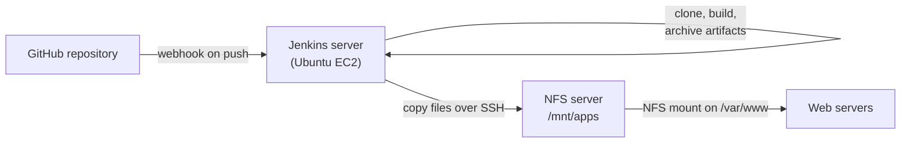

## Goals

- Understand continuous integration (CI) and why it is useful
- Install and configure a Jenkins server
- Trigger Jenkins builds automatically from GitHub using webhooks
- Copy build artifacts to the NFS server over SSH

## Environment

| Item | Value |
|------|-------|
| Cloud provider | AWS (free tier) |
| Region | eu-north-1 |
| Jenkins server | Ubuntu 26.04 LTS EC2 instance, Java 21 |
| Instance type | t3.medium |
| Other servers | NFS server and web servers from Project 7 |
| Connection | SSH from Windows PowerShell |

---

## Step 1: Installing and Configuring the Jenkins Server

I launched an Ubuntu EC2 instance and added an inbound rule for TCP port 8080, the port Jenkins uses:

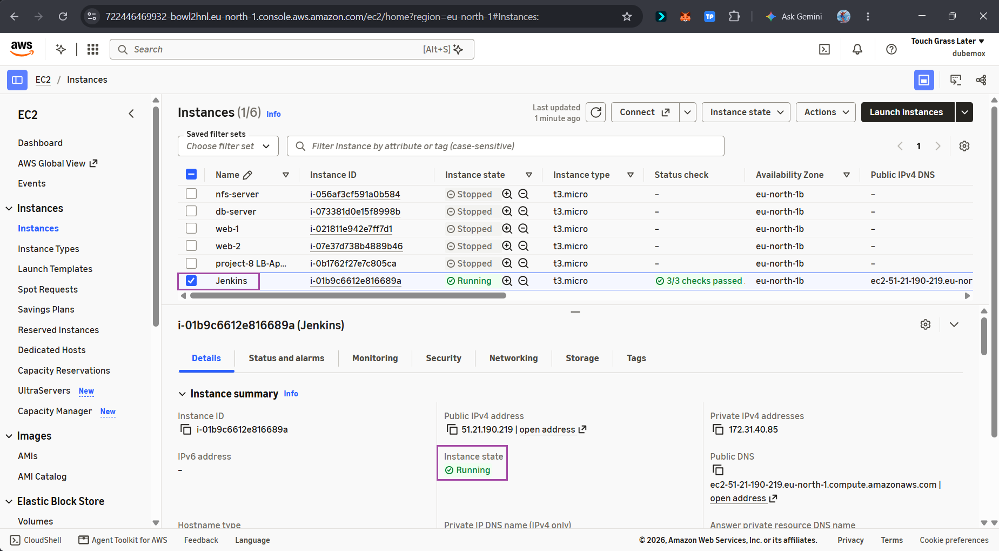

### Installing Java

Jenkins needs Java:

```bash
sudo apt update
sudo apt install -y fontconfig openjdk-21-jre
java -version
```

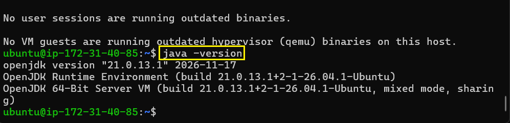

### Installing Jenkins

I added the official Jenkins repository and installed Jenkins:

```bash
sudo mkdir -p /etc/apt/keyrings
sudo wget -O /etc/apt/keyrings/jenkins-keyring.asc https://pkg.jenkins.io/debian-stable/jenkins.io-2026.key
echo "deb [signed-by=/etc/apt/keyrings/jenkins-keyring.asc] https://pkg.jenkins.io/debian-stable binary/" | sudo tee /etc/apt/sources.list.d/jenkins.list > /dev/null
sudo apt update
sudo apt install -y jenkins
```

I enabled and started Jenkins, then checked that it was running:

```bash
sudo systemctl enable --now jenkins
sudo systemctl status jenkins
```

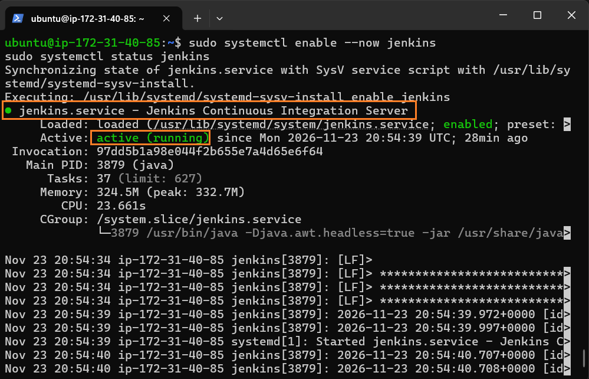

### Unlocking Jenkins

I got the initial admin password on the Jenkins server:

```bash
sudo cat /var/lib/jenkins/secrets/initialAdminPassword
```

Then I opened Jenkins in my browser and used the password to unlock it:

```text
http://<jenkins-public-ip>:8080
```

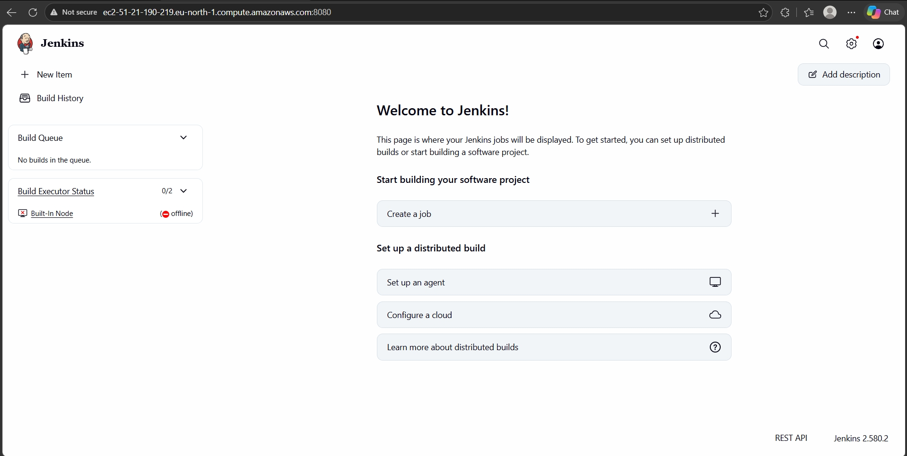

*(Then I installed the suggested plugins and created my admin user.)*

---

## Step 2: Configuring Jenkins to Retrieve Source Code from GitHub Using Webhooks

### Enabling the webhook in GitHub

In my GitHub repository (**Settings → Webhooks → Add webhook**), I added a webhook that notifies Jenkins on every push:

- **Payload URL:** `http://<jenkins-public-ip>:8080/github-webhook/`
- **Content type:** `application/json`
- **Events:** just the push event

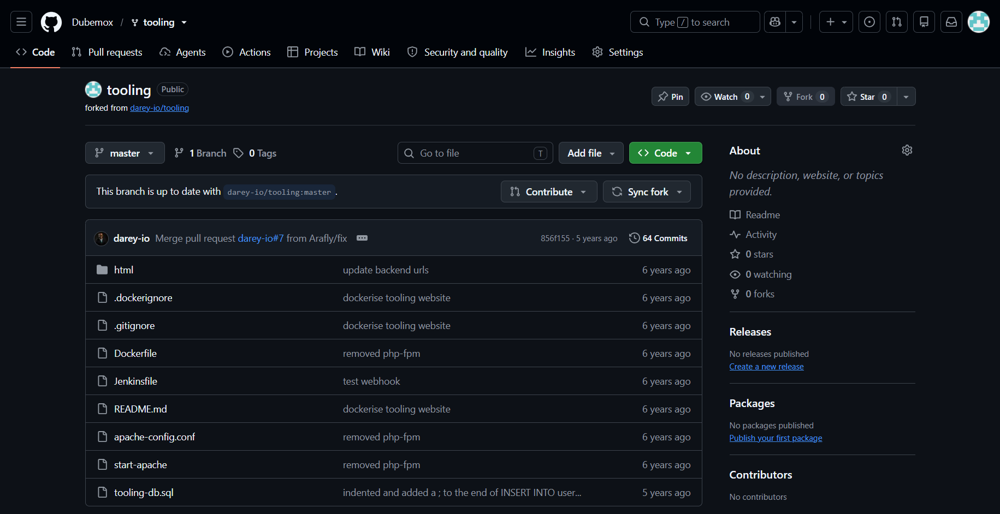

### Creating the Jenkins job

I created a **freestyle project** in Jenkins and configured it to retrieve the source code from my GitHub repository (**Source Code Management → Git**, with the repository URL and the branch to build):

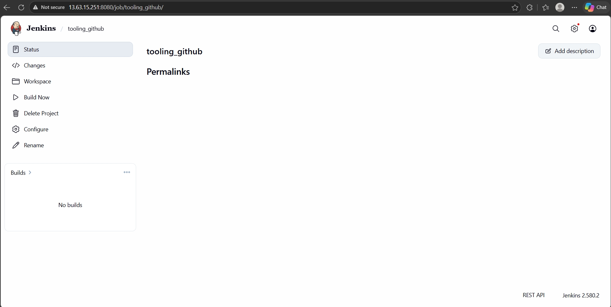

I ran a manual build to confirm that Jenkins could pull the code:

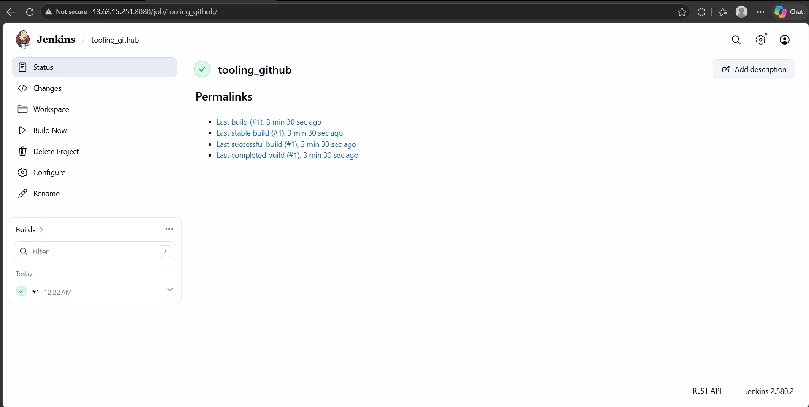

### Adding the trigger and archiving the artifacts

I then configured the job to:

- **Build when triggered by the GitHub webhook** (the build trigger "GitHub hook trigger for GITScm polling")
- **Archive the build artifacts** as a post-build action, so Jenkins keeps the files from each build

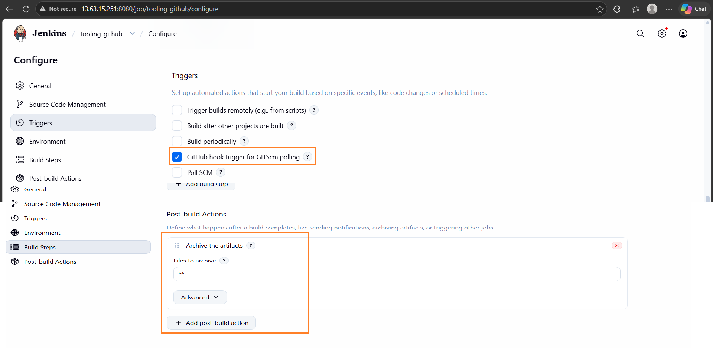

### Testing the webhook

I made a change in the repository and pushed it. Jenkins started a new build automatically:

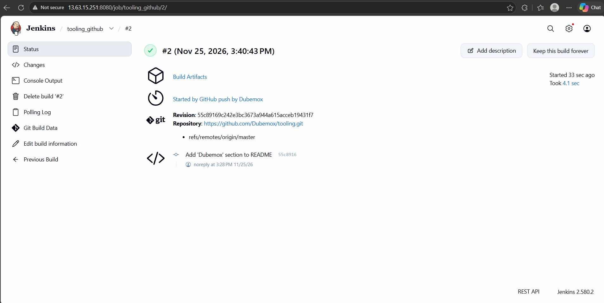

Archived artifacts are stored on the Jenkins server, in `/var/lib/jenkins/jobs/<job-name>/builds/<build-number>/archive/`.

---

## Step 3: Configuring Jenkins to Copy Files to the NFS Server over SSH

I installed the **Publish Over SSH** plugin (**Manage Jenkins → Plugins → Available plugins**):

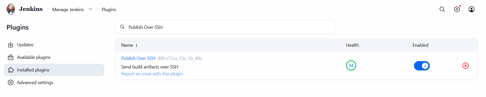

In Jenkins' system settings, I added the NFS server as an SSH server, using its **private IP**, the `ec2-user` username, and the remote directory `/mnt/apps`. For authentication, I pasted the contents of the key pair's private key:

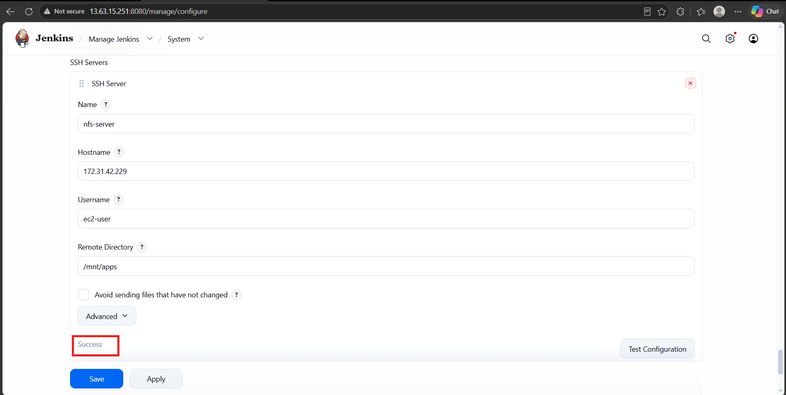

> **Important:** Never publish a private key or a screenshot that shows one.

Then I configured the job to copy the artifacts to the NFS server by adding a post-build action, **Send build artifacts over SSH**:

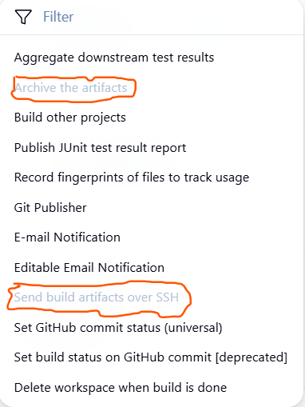

I ran the job again and checked the console output:


To confirm that the files arrived, I listed the NFS server's shared folder:

```bash
ls -l /mnt/apps
```

Because the web servers mount this folder on `/var/www`, they now serve the files that Jenkins delivers.

---

## Troubleshooting & Lessons Learned

- An EC2 instance gets a new public IP when it is stopped and started, unless it has an Elastic IP. When that happens, the GitHub webhook URL (and Jenkins' own URL setting) must be updated, or builds will stop triggering.
- If the webhook doesn't trigger a build, check the **Recent Deliveries** tab of the webhook in GitHub, and make sure port 8080 is reachable from GitHub.

## Cleanup

To avoid unexpected charges and exposure:

- Stop or terminate the Jenkins instance when I'm not using it.
- Delete the GitHub webhook if the Jenkins server is removed.
- Close port 8080 when it is no longer needed.

## Author

Dubemox · Lagos, Nigeria.